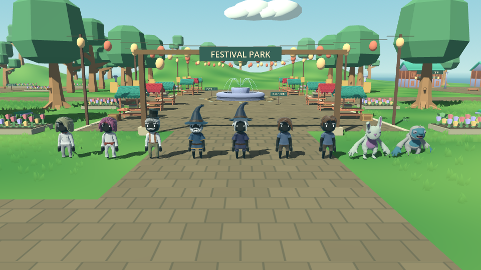

# Bazaar 0.0.5 — people, animal folk and birds

Historical 0.0.5 evidence. See [0.0.6 additions and skin/animation checks](RESIDENT_APPEARANCE.md) for the current population.

14 November 2026. Local standalone prototype on `codex/bazaar-world-20261114`.
The owner's follow-up asks for a mixed population with **more humans**: this build
has **11 humans, two rabbits and two yetis**, plus **six birds**. They are NPC
scenery, never directory visitor counts or simulated connected players.

The lineup above is an isolated visual review arrangement. In normal play the
residents are distributed among stalls, shop rooms and pedestrian routes.

## Behavior

- Six merchants attend park stalls; three attend the tea shop, tailor and curios
  shop. They idle out of phase and turn toward a nearby visitor. Rabbit/yeti
  merchants can wave, using their original native clip and a 14-second cooldown.
- E/A or the existing touch Inspect button introduces each merchant through the
  existing menu. The copy explicitly says trading is in development. There is no
  new purchase, goods, custody, rental or Sparks path.
- Four pedestrians follow the park promenade around the fountain; two stroll
  around Town Square. They pause at corners, turn before walking and stop within
  1.35 m of the player. NPCs are nonblocking scenery: the player can pass through
  them, so they cannot trap a player or close a shop entrance.
- Six purple birds use the original wing animations. Two flutter lower in the
  park; the others circle above the districts. Nearby birds climb and accelerate,
  then return to their normal flight. This increment has no landing/pecking or
  bird sound system.
- A fixed population avoids spawn churn. Distance checks run four times/second;
  behavior and animation stop beyond 52 m, figures disappear beyond 64 m. Interior
  entry naturally sleeps distant outdoor NPCs. Menus pause NPC movement/animation.
  These bounds are not a claim of handheld FPS.

[Park](population-evidence/park.png) · [Tea merchant](population-evidence/tea-merchant.png)
· [Birds](population-evidence/birds.png) · [Four-second movement review](population-evidence/park-motion.mp4).
The movement review samples fixed simulation time at 12 frames/second; it is not
an on-device performance recording.

## Models and licensing

Quaternius [Ultimate Animated Character Pack](https://quaternius.com/packs/ultimatedanimatedcharacter.html)
provides seven human appearances: Casual Female/Male, Chef Female, Kimono Female,
Old Classy Male, Wizard and Witch. [Ultimate Monsters](https://quaternius.com/packs/ultimatemonsters.html)
provides Big Bunny, Big Yeti and Flying Pigeon. Both original pack pages specify
CC0. Original author-supplied notices are preserved in `licenses/` and in all three
platform archives.

The author-linked Google Drive downloads returned quota exceeded. A public CC0
mirror supplied the archives, with the exact download links and source/output
hashes in [animal provenance](../assets/residents/provenance.json) and
[human provenance](../assets/residents/humans-provenance.json). The Monsters source
notice says “Ultimate Platformer Pack”; it is retained verbatim, with the explicit
Ultimate Monsters page's CC0 declaration recorded separately. No claim is made
that these hashes were independently obtained from the quota-limited Drive files.

`tools/import_residents.py monsters.zip characters.zip` losslessly packages the
embedded glTF buffers as GLB. [Asset checks](population-evidence/asset-checks.json)
verify unchanged source JSON/binary data, including skins and animation tracks.
Runtime uses native rigs, with uniform whole-model scale and clip selection; it
does **not** retarget NPCs through the player's SDK skeleton. Bunny's optional
carrot weapon mesh is hidden. Combat/death clips are unused. The original model
files, notices and animation data remain intact.

The asset search also considered Plumberry Plains and Juggy's LowPoly Animals.
Their raw-file redistribution restrictions do not fit this public source repo;
none of those models are committed or packaged.

## Verification and delivery

- [Population checks](population-evidence/checks.json): fixed population and human
  majority; 1,920 sphere samples along all walking routes clear static obstacles;
  player yielding/resume, merchant interaction and greeting cooldown, bird escape,
  distance sleep and menu pause/resume. Native clip samples preserve bind matrices
  and finite rotations. `tests/population_checks.gd` reproduces the checks.
- [Existing world walkthrough](population-evidence/headless.log): PASS, including
  camera, movement/collision, shops, input/menu and SDK fixture appearance.
- [OpenGL world review](population-evidence/render-final.log) and
  [nine-model animation review](population-evidence/cast.log): completed without
  script/import/shader/resource errors. `tests/population_review.gd` captures the
  actual world; `tests/resident_cast.gd` samples Idle/Walk phases for all appearances.
- [Exported Linux window/menu exit](population-evidence/native.log): exit 0;
  [actual 800×450 window](population-evidence/export.png). Rendering uses Mesa
  llvmpipe/Xvfb on the server, not handheld hardware.
- Windows x86_64, Linux x86_64 and Linux ARM64 exported with pinned Godot 4.7.2.
  [Build hashes](population-evidence/build-manifest.json),
  [verified ZIPs](population-evidence/package-sha256.json),
  [72 matched runtime source inputs](population-evidence/source-sha256.json).
  Windows/ARM64 exports have not been executed on target systems.

An early very short headless population-only test emitted the existing fountain
playback teardown warning; a verbose follow-up was clean. That suite now retires
unrelated fountain audio at setup. Final population, world, rendered and native
exit logs are clean apart from the renderer's expected root/VSync notices.

Local packages are in TrainerOS's ignored `build/bazaar-life/packages/`; server
builds are isolated under `traineros-bazaar-20261110/life-export/`. Version 0.0.4
remains the prior rollback. No merge, catalogue publication, Backend deployment or
handheld installation. Real hardware FPS/controls, networked NPC synchronization,
full crowd avoidance, foot IK, live merchant inventory and trading remain pending.
All Bazaar spending stays closed.
