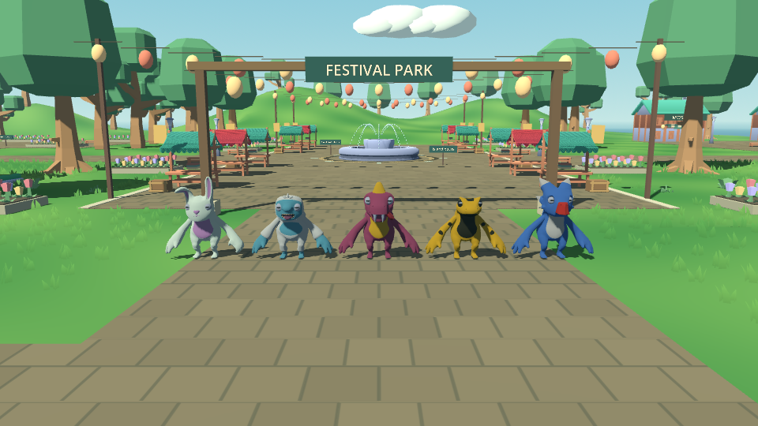
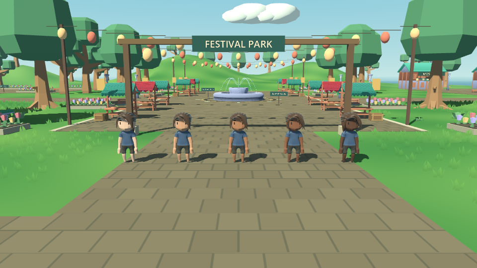

# Bazaar 0.0.6 — more animal folk and human complexions

14 November 2026. Adds three resident types from the same CC0 Quaternius Ultimate
Monsters archive: **Dino**, **Frog** and **Birb**. Dino/Kip and Birb/Sora attend two
previously empty park stalls; Frog walks the clear central paths of Garden Court.
The local population is now **18 NPCs: eleven humans and seven animal folk**, with
eleven merchant roles and seven pedestrians. The six flying birds are unchanged.

Humans use five warm skin tones. Per-instance overrides target only the vendor's
`Skin` and `Face` surfaces: exposed skin changes together, and the original eyes
and mouth become dark for readability. Clothing and hair retain their original
materials. Variants are assigned deterministically, with a bounded material cache;
they do not recolor another character or change the profile avatar SDK.

[All human appearances](resident-evidence/people.png) ·
[Dino's stall](resident-evidence/dino-stall.png) ·
[Birb's stall](resident-evidence/birb-stall.png) ·
[Garden walker](resident-evidence/garden-walker.png) ·
[Tea merchant](resident-evidence/human-merchant.png).
The lineup shots are an isolated visual review arrangement; the other images show
normal world placement.

## Animation investigation and correction

Native source rigs, geometry, weights and animation tracks remain unchanged. The
three additional files are losslessly packaged from the original archive by
`tools/import_residents.py`; [provenance](../assets/residents/provenance.json) and
[13-model buffer/hash comparison](resident-evidence/asset-checks.json) record this.
Existing [CC0 notices and mirror provenance](POPULATION.md#models-and-licensing)
continue to apply. Human recoloring is a runtime material override, not a skinning
or rig edit.

The checks exposed a sharp movement already present in the animal **Wave** clip:
the original upper-arm keys rotate about 42.38° between 0.4333 and 0.4667 seconds.
This is authored fast movement, not a broken retarget. Greetings now play at
**0.65×**, with the greeting duration adjusted accordingly, so the next Idle does
not cut them short. Initial playback has no unnecessary rest-pose fade; subsequent
Idle/Walk/Wave changes retain the 0.18-second blend.

The maximum sampled animal vertex movement at 60 Hz fell from **0.6355 to 0.4148
native units/frame**; the figures are uniformly scaled to roughly half that size
in the world. The existing 0.5-unit check was retained. The early diagnostic also
flagged approximately 0.00002 imported scale round-off in Chef leg bones. The
scale-invariance comparison now allows 0.0001, while bind matrices must remain
unchanged. No asset bones were rescaled to satisfy the test.

[Original-speed diagnostic](resident-evidence/appearance-diagnostic.json) ·
[Final checks](resident-evidence/appearance.json) ·
[Wave pose](resident-evidence/wave.png) · [Side view](resident-evidence/side.png) ·
[Sampled greeting clip](resident-evidence/greeting.mp4).
The short video uses 12 normalized source-pose samples over the new greeting's
2.56-second duration. It is a pose review, not a realtime FPS measurement.

## Verification

- `tests/resident_appearance_checks.gd`: all **13** model types, native Idle/Walk
  and their transitions, Wave where available, both bird flight clips. At least
  two clip durations are advanced at 60 Hz. All bone rotations remain finite,
  bind matrices unchanged and scales stable within import precision. Sampled
  CPU-skinned surface vertices remain bounded, without large frame jumps.
- The same check tests **35 human model/tone combinations**, including independent
  colors on simultaneous instances, dark face details and unchanged clothing,
  hair and original material resources. [Log](resident-evidence/appearance.log).
- [Population checks](resident-evidence/population.json): 18 NPCs, human majority,
  **2,020 route clearance samples**, player yielding, greeting cooldown and return
  to Idle, merchant interaction, bird reactions, distant sleep and menu pause.
- [Existing world walkthrough](resident-evidence/headless.log): PASS. Camera,
  movement/collision, shops, controls/menu and SDK fixture appearance still work.
- [Cast review](resident-evidence/cast.log): humans, animals and skin variants,
  front-cycle samples and side views. [Actual-world review](resident-evidence/world.log)
  checks both new stall attendants, the garden walker and a recolored shopkeeper.
- [Linux exported window/menu exit](resident-evidence/native.log): exit 0. All
  final logs are free of script/resource errors; expected server root/VSync
  notices remain. Tests/rendering used pinned Godot 4.7.2 and Mesa llvmpipe/Xvfb.
- Three platform exports: [binary hashes](resident-evidence/build-manifest.json),
  [verified archives](resident-evidence/package-sha256.json),
  [75 matched runtime source inputs](resident-evidence/source-sha256.json).
  Windows and ARM64 are export-only; physical controls and handheld FPS are not
  verified. Unused combat/death clips are outside this review.

Packages are in TrainerOS's ignored `build/bazaar-residents/packages/` and isolated
server `residents-export/`; 0.0.5 remains the prior rollback. Separate branches,
no merge, catalogue publication, server deployment or device installation. NPCs
remain local scenery. Crowd collision avoidance, foot IK, live trading and Sparks
spending are unchanged/unavailable; the player can still pass through NPCs.
