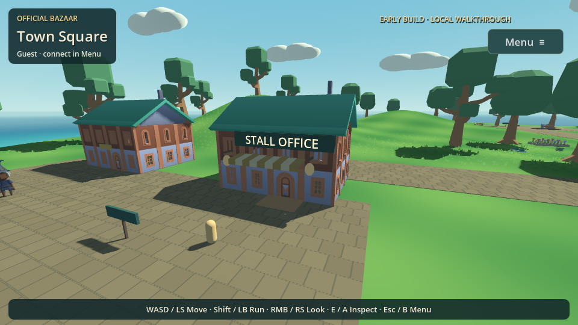
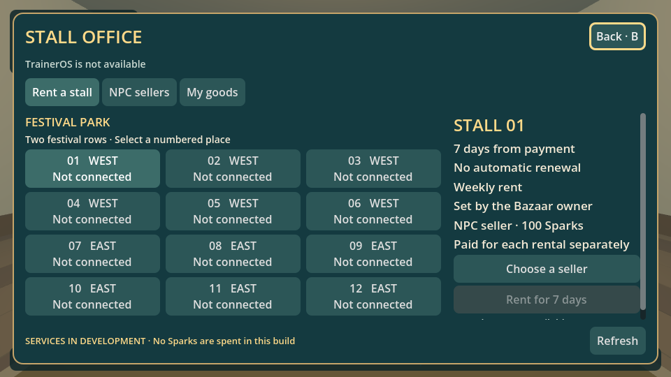
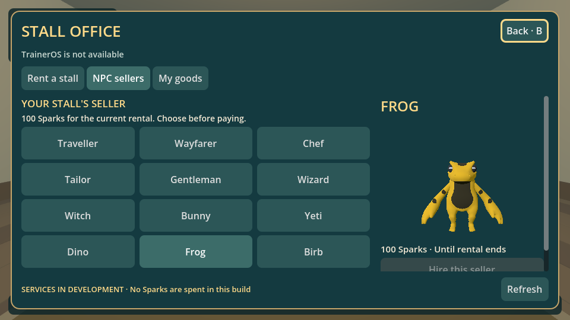

# Bazaar — rental office and service integration

**20 November:** Bazaar 0.0.11 opens a labelled overhead park map at Vale’s desk, a goods shelf at each counter, and a pattern book at THREAD. [Current screens and checks](counter-evidence/README.md).

**14 November:** 0.0.9 source handles queued refresh and stale replies,
and reads NPC offer prices from the server. Backend reads and the verified
official owner binding are live; handheld shells were not updated. Paid operations
remain closed. [Current evidence](response-evidence/README.md).

## 14 November 2026 — corrected handheld entry

Use **Online → Bazaar → Official Bazaar** on both handhelds. Shell sequence 43
opens the existing island 0.0.7 and returns to its catalogue card; the Apps-only
route below is superseded. Commerce remains closed. [Evidence](https://github.com/EriArk/OctoFox-OS/blob/codex/bazaar-catalogue-20261110/docs/evidence/2026-11-14-bazaar-entry/README.md).

## 14 November 2026 — Bazaar 0.0.7 handheld installation

Installed the ARM64 walkthrough on Flip 2 and Odin 2, with owner authorization:
**Apps → Bazaar (Alpha 0.0.7)**. Real-device launch, own SDK avatar, island rendering,
remote movement/menu and return to Apps were observed. Existing shells remain
unchanged; they lack `bazaar.read`, so commerce stays unavailable. Physical input,
audio and sustained performance remain owner acceptance. No merge or public release.
[Delivery record](https://github.com/EriArk/OctoFox-OS/blob/codex/bazaar-catalogue-20261110/docs/evidence/2026-11-14-bazaar-handheld/README.md).

The visitor walks to **STALL OFFICE** on the southern side of Town Square, enters
its room and talks to Vale at the counter. The room has a park plan and lease
ledgers. The park still contains twelve physical stalls; they now open their own
goods interface instead of a general NPC greeting. THREAD opens avatar clothing.
There are four enterable rooms and nineteen ambient NPCs (twelve humans/seven
animal folk), plus the existing six birds.

The office exposes a dense numbered place picker, rental terms, seller previews
and own listings. Keyboard, controller Confirm/Back and touch use the existing
world interaction. Opening services pauses world movement/residents; closing
restores exploration. Both columns scroll when needed; Back/Refresh remain visible.

Twelve existing human/animal models can be previewed on their original rigs. Hiring
costs **100 Sparks for this rental**, not a permanent unlock. Server-assigned NPCs
replace ambient appearances at their numbered place, with bounded activity. Losing
account/connection clears that projection and restores scenery. Local previews
never persist rented places or ownership.

## Real source integration versus unfinished gameplay

The new game client reuses the existing SDK transport; host-owned Backend credentials
never enter the game. `bazaar.read` supplies world mappings, seller offers, paged
public/own listings and costume offers. Missing world binding, sign-in, server errors
and confirmed empty results stay distinct. No local balance or possession is invented.

The [Backend branch](https://github.com/EriArk/OctoFox-OS/blob/codex/bazaar-catalogue-20261110/services/backend/bazaar-trading.md)
prepares rental-scoped seller purchases, listing/withdrawal and atomic ownership/
Sparks transfer with private idempotent receipts. Official ownership belongs to the
user and does not consume his personal Bazaar; he sets weekly rent. Operator
registration verified the Lobby application owner and has now run on the existing
server. Twelve places are mapped; weekly prices remain unset.

**This build does not enable in-world payments.** The service screens explicitly
say so and disable payment/listing actions. Trusted host confirmation and durable
recovery are not implemented for those SDK writes; save custody remains absent.
Traveller, Mage and Merchant are planned new avatar costumes at **50 Sparks each**
for alpha, stored as unavailable server offers. Their meshes, fitting, ownership/equip
and purchase delivery are not implemented. NPC clothing is not sold as avatar clothing.
Free wardrobe garments stay free. Crafting, blueprints and an Orbiter-like personal
home remain future work, not implemented services.

## Verification

- `tests/services_checks.gd`: office entry/exit, twelve numbered stalls, clerk versus
  ambient interaction, all twelve native seller previews, server price projection,
  no fake checkout, revocation cleanup, controller Back, tailor and stall routes.
- `tests/population_checks.gd`: nineteen ambient NPCs, six birds, 2020 route samples,
  activity, pause/resume and updated stall interaction.
- Existing world walkthrough passed with the shared SDK avatar fixture. No personal
  character is bundled; headless checks are not physical gameplay acceptance.
- OpenGL UI review at 960×540 and 800×450 on Xvfb/Mesa; screenshots above show the real disconnected build.
  A first layout overflow was corrected by independently scrolling the columns.
- Linux x86_64 exported executable opened a real X11/OpenGL window and exited
  through Leave Bazaar with code 0. Windows and ARM64 were exported only.
  [Build hashes](service-evidence/build-manifest.json), [archive hashes](service-evidence/package-sha256.json).
- TrainerOS Backend and native socket/build evidence is recorded in the linked
  Backend contract. No tests use live balances or game saves.

Separate branches. No catalogue release, production deployment, merge or handheld
installation. Physical controller/touch, performance, audio and Windows/ARM64
execution remain unverified.
