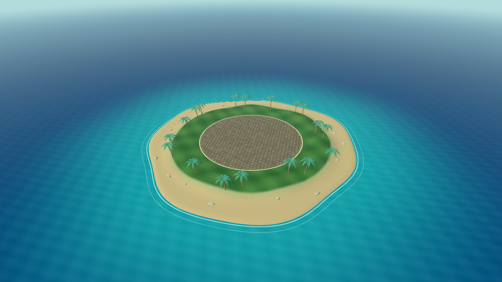
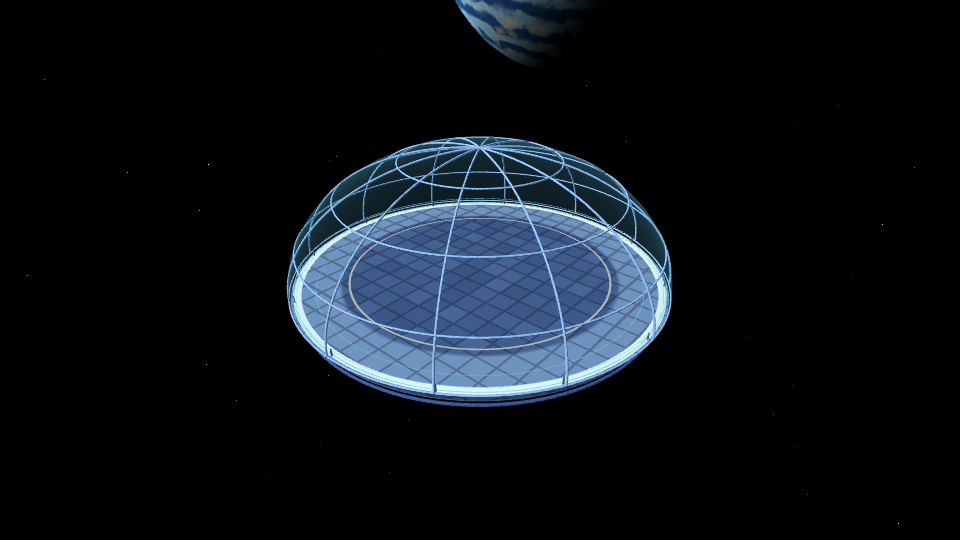

# Personal starting worlds — 14 November 2026

The owner's personal Bazaar is **one empty square**, expanded later by buying
shops, stalls, training arenas, social places and similar facilities. This is
separate from the multi-district official island and the future private home.

Version 0.0.10 adds two local starting grounds:

- **Mika / island:** a roughly circular sea island, a 48 m wide empty paved square,
  a grass and palm rim with low dunes, a broad walkable beach and animated surf.
- **Ren / station:** a circular orbital deck, the same 48 m wide empty central
  square, a transparent curved glass dome, structural ribs, perimeter rails,
  stars and a shaded gas giant outside.

These are local test worlds, not granted player-owned venues. No purchases,
stock, stalls, shops, arenas or multiplayer sessions are provisioned. The only
shared game systems are the existing SDK character, motor, camera, input, pause
and ordinary process lifecycle. Official services/population are not instantiated
in personal worlds. The official Festival Park remains the default launch.

```
godot --path games/bazaar -- --world=island
godot --path games/bazaar -- --world=station
```

Only `official`, `island` and `station` are accepted. Unknown world arguments exit
with an error. The shell uses fixed desktop entries, never commands supplied by a
server directory row. Missing installed worlds retain the explanatory preview.

## Geometry and performance boundaries

All new scenery is authored procedural geometry/shaders under the project GPL;
no newly downloaded textures/models are required. The island reuses the existing
bounded grass mesh/shader with 6,500 tufts in spatial MultiMesh chunks. Terrain has
real collision and a level construction pad. Sea color/foam follow the same coast
function, with derivative filtering; no depth/refraction passes. The station uses
one glass shell, combined rib geometry and a closed perimeter collision. There
are no real-time reflection probes, volumetrics, per-pixel lights or idle NPCs.
A single directional shadow light is bounded to 65 m in both worlds.

The SDK motor and approved avatar rig are unchanged. World-specific fall height,
arrival and radial recovery are configured in the game walker; the official
world retains its previous values. Main menu audio preferences remain compatible.

## Validation

Headless physics scenarios passed for both personal worlds: arrival, nine points
across the empty pad, running, pause, fall recovery, beach support / station edge.
The official walkthrough regression also passed. Render checks inspect arrival,
shore/edge, exterior overview and catalogue covers in Compatibility/OpenGL.
The resulting catalogue images show shipped scenery rather than concept art.
Host render timings are not handheld performance acceptance.

## Installed delivery

**Bazaar 0.0.10 / Software 47** is installed on **Flip 2 and Odin 2**. Game source
`029ff24e4a5affee524287e3bfc5be04be37fa75` and shell source
`a1eb3c6829e380793231c02473cac28003b9aaf1` remain on their separate branches;
no merge or public release. [Package](evidence/package.json).

Both devices passed observed card entry, profile avatar loading, movement,
menu and normal Leave for island, station and official Festival Park. Catalogue
selection/scroll returned correctly; game logs had no errors/warnings. Verification
checked running binary hashes, database integrity and unchanged profile counts /
game settings. [Flip](evidence/flip-verification.json),
[Odin](evidence/odin-verification.json). Input was remote keyboard/pointer;
physical controller/touch and sustained performance are still owner acceptance.

Task staging and superseded game 0.0.8 / Software 45 were cleaned after checking
live references. **Game 0.0.9 and Software 46** remain as verified rollback.
[Flip cleanup](evidence/flip-cleanup.json), [Odin cleanup](evidence/odin-cleanup.json).
Private backups and personal data remain on each device. No sleep/lid tests.

[Island physics](evidence/island-checks.json),
[station physics](evidence/station-checks.json),
[official regression](evidence/official-checks.json) all passed. All three exports
completed; normal exported x86-64 startup passed for both personal variants.

### Actual world overviews

These renders contain no personal avatar or account data.





Paid facility placement, provisioned player ownership, commerce and peer-hosted
multiplayer are not part of these local frames.
