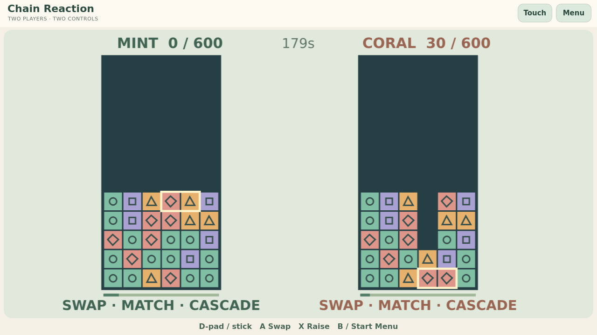

# Chain Reaction

**Prepared update (not published):** 0.1.1 improves controller input, field size and effects.
[Repair details and acceptance boundary](../docs/controls-and-presentation.md).

Swap coloured tiles, build cascades and send blocks to your rival.



## Play

- **Practice with bot**: offline solo practice.
- **Two on this device**: simultaneous independent Mint/Coral controls.
- **Play with a friend**: the existing TrainerOS GameHub Lobby and SDK record channel,
  with mutual rematch and room-preserving exit/rejoin. See [the shared journey](../arcade-common/README.md).

Move a horizontal two-tile cursor, then **Swap**. Three or more matching colours in
a horizontal/vertical line clear together, with a short flash before gravity. Every
colour has its own symbol. Cascades multiply points and send stronger attacks;
large first clears also attack. Grey incoming rows arrive after a visible grace
period, cannot be swapped, and disappear beside a clearing colour match.

**Raise** adds a row; the field also rises every eight seconds. First to 600 points
wins; a full stack loses. After three minutes, most points wins. Simultaneous wins
or losses draw. The practice bot searches visible swaps, then raises when no
immediate clear exists. No ranked results, currencies or tournaments are submitted.

## Controls

| Input | Move | First action | Second action |
| --- | --- | --- | --- |
| Solo / online keyboard | Arrows or WASD | Enter, Space or F | Shift or G |
| Local Mint | WASD | F or Space | G |
| Local Coral | Arrows | Enter | Shift |
| Each controller | D-pad | SDL Confirm (A mapping) | SDL X mapping |
| Touch | Visible arrows | Labelled action button | Labelled action button |

Back/Escape or controller Back/Start opens the exit confirmation. Offline play
pauses when focus is lost; online play continues with held directions released.
Actions are discrete: holding an action does not repeat it. Directions repeat on
the simulation clock. Local controller 1 owns Mint, controller 2 owns Coral;
online controller 1 owns the local seat. Physical glyph adaptation belongs to the
shared controller follow-up and is not claimed here.

## Build and preparation

```sh
cmake -S games/competitive-minigames -B build/puzzles -DCMAKE_BUILD_TYPE=Release -DARCADE_GAMES=chain-reaction
cmake --build build/puzzles --parallel 3
./build/puzzles/chain-reaction --windowed
python3 games/competitive-minigames/arcade-common/package.py chain-reaction build/puzzles/chain-reaction dist/chain-reaction
```

C++20, Qt 6.4+ Quick/Network and SDL2. Original code and SVG/Canvas artwork are
GPL-3.0-or-later; [LICENSE](LICENSE). The complete source archive includes all shared
rule implementations needed by the suite. [Preparation and verification](../docs/puzzle-trio-preparation.md)
separates desktop evidence from the main chat's publication, ARM and device work.
This game is prepared for Experimental 0.1.0; this document does not announce a release.

The [original concept](docs/idea.md) is retained as history. Common community/social,
ranked and tournament ideas are not implemented by this package.
