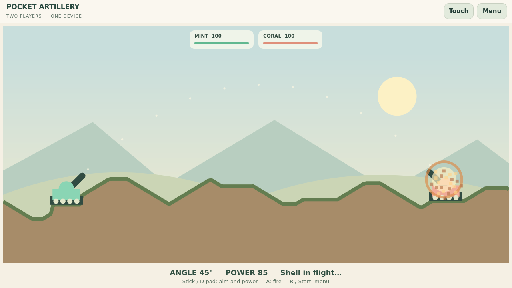

# Управление и игровое поле — исправление 22 октября 2026

## Публикация и доставка, 22 октября 2026

Подготовка ниже завершилась публикацией всех девяти 0.1.1 из `037bdd5` в
[GitHub Releases](https://github.com/EriArk/crates/releases), x86_64/aarch64.
ARM64 собран нативно: Fedora 44 / Qt 6.11.2 / GCC 16.2.1; 30 проверок аркад
и 7 Artillery прошли. Содержимое source archive сверено с указанным коммитом.
Публичные 18 архивов проверены по размеру/SHA256, подпись каталога проверена.

Каталог TrainerOS ревизии 18 содержит 15 проектов/33 записи. На Odin и Flip
Update all обновил четыре старые игры до 0.1.1 с сохранением данных/истории;
пять новинок установлены Download. На Odin Artillery прошла Versions → 0.1.0 →
Update → 0.1.1. Запуски Tanks/Racing на Flip и Artillery на Odin — ограниченные
проверки с синтетическим вводом. Физические контроллеры и интернет-матч не приняты.
Доставка использует прежнюю оболочку и её существующий механизм обновлений.
Обоим участникам Artillery нужна 0.1.1 из-за `pocket-artillery.2`.
Подготовительные ограничения ниже сохранены как история этапа.

Подготовительная ветка `codex/game-controls-polish` продолжает `codex/brick-duo`
(`336c83e`, включая `bc10d5f`). Версия пакетов **0.1.1 подготовлена**, но эта
ветка сама не публикует релизы, каталог, ARM-сборки и обновления портативок.

## Причины и охват

Исправляются все девять реализованных игр: Pocket Artillery, Pong, Snake Arena,
Light Cycles, Falling Blocks, Minesweeper Race, Chain Reaction, Brick Racing и
Brick Tanks. Остальные папки идей не выдаются за готовые игры.

Раньше два независимых обработчика читали только SDL-события кнопок: аналоговые
оси не обрабатывались. SDL не получал явного разрешения собирать события без
собственного активного видеоокна, хотя окно принадлежит Qt. Постоянная нижняя
панель уменьшала поле; внутриигровые подписи уменьшались вместе с Canvas. Общие имена семейств шрифтов также
давали неподходящую подстановку; теперь используется явное семейство приложения.
В артиллерии проигрывались две точки траектории каждые 16 мс.

Предыдущие проверки клавиатурой и синтетическими касаниями не подтверждали
работу физических контроллеров. Исторические записи об установке остаются
историческими; текущая жалоба владельца требует повторной аппаратной приёмки.

## Что изменилось

- Один `arcade-common/ControllerInput.h` используется всеми девятью играми.
  SDL собирает ввод без SDL-окна, а Qt-фокус разрешает или блокирует команды.
  Левый стик имеет мёртвую зону и гистерезис; крестовина имеет приоритет.
  Кнопки передают игровые действия непосредственно, без имитации клавиатуры.
- Два контроллера сохраняют места игроков при отключении. Локальная игра
  приостанавливается при потере контроллера/фокуса; в сетевой обнуляется ввод.
  Удерживаемые при возврате фокуса органы управления сначала нужно отпустить.
  Единственный оставшийся контроллер управляет своей стороной одиночного/
  сетевого режима, а в локальной паре сохраняет исходное место.
- Стик/крестовина управляют меню, подтверждение запускает матч/реванш;
  Back и Start открывают меню. В танках удержание основной кнопки повторяет огонь
  с сохранением игрового ограничения перезарядки. В остальных играх дискретные
  действия остаются дискретными. Подсказки различают Xbox/Steam, PlayStation и
  Nintendo по типу, сообщаемому SDL. Используется стандартная база сопоставлений
  SDL; нестандартные устройства требуют корректного SDL mapping, универсальная
  поддержка неизвестных устройств не заявлена.
- При вводе геймпадом/клавиатурой панель экранных кнопок скрывается. Касание или
  кнопка Touch возвращают её; обе локальные стороны сохраняют сенсорные действия.
  Высота поля при 640×480 без панели выросла с 284 до 380 пикселей; пропорции
  игровых полей сохраняются. У гонок плотнее компоновка и крупнее машины,
  у всех игр увеличены подписи. Клавиатурные сочетания восстанавливают оставшееся
  удерживаемое направление после отпускания другой клавиши.
- Эффекты: шлейф и отскок мяча, подбор еды, столкновения световых циклов,
  постановка/очистка блоков, открытие клеток/подрыв мины, каскады, Boost/аварии,
  вспышки выстрелов и разрушение кирпичей. Частицы ограничены по количеству,
  существуют только в отрисовке и не входят в синхронизируемое состояние.
- Артиллерия показывает одну точку полёта за 24 мс и отдельную фазу взрыва
  продолжительностью 576 мс. Камера сохраняет пропорции и показывает высокий
  полёт. Корпуса крупнее; дульная точка и область попадания согласованы с ними.
  **Протокол `pocket-artillery.2`: обновить обоих участников.** Старый `.1`
  несовместим с новыми областями попадания и не должен смешиваться с `.2`.
  Остальные восемь игр сохраняют правила и протоколы.



## Проверка и воспроизведение

Сборка Windows: Qt 6.11.1, SDL2, CMake/Ninja. Linux: Qt 6.4.2 в изолированном
контейнере, без обращения к производственным сервисам. Тесты используют
`SDL_JoystickAttachVirtual` и штатное SDL-сопоставление контроллера, затем проходят
через тот же `ControllerInput`, что и игровые исполняемые файлы. Это существенно
сильнее инъекции Qt-клавиш, но не подменяет аппаратную приёмку.

```sh
cmake -S games/competitive-minigames -B build/arcade -G Ninja -DBUILD_TESTING=ON
cmake --build build/arcade
ctest --test-dir build/arcade --output-on-failure
cmake -S games/competitive-minigames/pocket-artillery -B build/artillery -G Ninja -DBUILD_TESTING=ON
cmake --build build/artillery
ctest --test-dir build/artillery --output-on-failure
```

`arcade-common/tests/prepare_linux.py` воспроизводит сборку/проверки на явно
заданном build-host в отдельном `/tmp/crates-*`; требует доступный образ
`traineros-ci:20260911` и путь к SDK installer source. HostIntegration артиллерии
отдельно использует настоящий PlatformHost/SdkNetwork и TLS helper: матч,
равенство состояний, взаимный реванш, выход/rejoin, отзыв профиля и отклонение
поддельных результатов. Ранее пройденные сетевые проверки восьми аркад
сохраняются: их сетевой код и правила не изменены.

В подготовительной копии доказательства находятся в `build/polish/`,
`build/artillery/`, `build/polish-linux/`; готовые архивы и records — в
`dist/prepared-input-<slug>/`. Каждый пакет содержит свой source archive и
SHA256SUMS. Источник артиллерии включает общий ввод и SDL test fixture.

## Зафиксированные результаты

- Windows и Linux: 30 сценариев аркад, 7 сценариев артиллерии, без ошибок.
- После уточнения подписи Nintendo для label/position режима SDL повторены
  сценарии контроллера, фокуса и отключения, а также стрельба артиллерии.
- 24 детерминированных матча восьми аркад дают те же хеши на Windows/Linux;
  новый итоговый хеш правил артиллерии также одинаков на обеих платформах.
- SDK/TLS артиллерии: полный цикл, реванш, rejoin, отзыв профиля и защита
  состояния прошли. Это локальная интеграционная проверка, не интернет-приёмка.
- Все девять Linux x86_64 пакетов: настоящие installer/managed launcher, запрет
  удаления запущенного пакета, остановка, удаление/переустановка с сохранением данных.
- Архивы исходников восьми аркад и артиллерии собираются отдельно, включая
  тестовые цели; общий ввод не потерян при упаковке отдельной артиллерии.
- Снимки 640×480 и 1280×720 проверены отдельно от прохождения тестов.

## Передача основному чату

1. Забрать всю ветку поверх подготовленных puzzle/brick изменений; не выбирать
   отдельные QML-файлы без общего ввода и ресурсов эффектов.
2. Собрать ARM64 из того же коммита, проверить настоящий контроллер и touch на
   Odin/Flip: меню → матч → пауза/возврат → отключение/подключение → реванш → выход.
   Проверить оба места локальной пары и своё место сетевой игры.
3. Проверить читаемость при реальном размере экрана, высокие выстрелы артиллерии,
   темп и ощущения от эффектов. Снимок рабочего стола не является такой приёмкой.
4. После приёмки публиковать версии 0.1.1 и каталог обычным процессом. Сохранить
   ограничения SDK/сетей; эти изменения не доказывают игру через разные сети.

Публикация и установка этой версии здесь не выполняются. Эмуляторные адаптеры,
сохранения, основной TrainerOS runtime и существующая инфраструктура не меняются.
