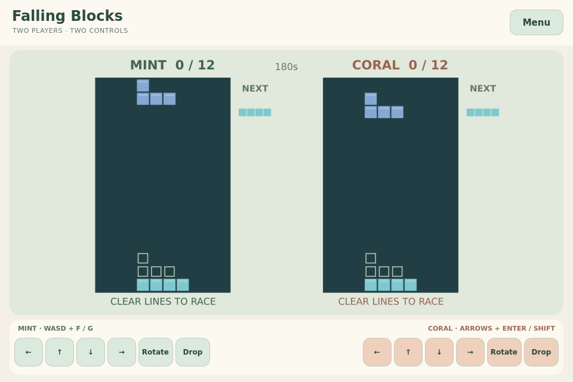

# Falling Blocks

A two-player falling-block race. Clear 12 lines before your rival.



## Play

- **Practice with bot**: offline solo practice.
- **Two on this device**: simultaneous independent Mint/Coral controls.
- **Play with a friend**: the existing TrainerOS GameHub Lobby and SDK record channel,
  with mutual rematch and room-preserving exit/rejoin. See [the shared journey](../arcade-common/README.md).

Both players receive the same seeded piece stream. Move left/right, soft-drop with
Down, **Rotate** clockwise with small wall kicks, or **Drop** to lock immediately.
The landing outline and next piece stay visible. A blocked spawn loses; simultaneous
losses or simultaneous target scores draw. After three minutes, most lines wins.
The practice bot evaluates visible placements for holes, stack height and line clears.
There is no hold, garbage attack, ranking or claim of a standard rotation system.

## Controls

| Input | Move | First action | Second action |
| --- | --- | --- | --- |
| Solo / online keyboard | Arrows or WASD | Enter, Space or F | Shift or G |
| Local Mint | WASD | F or Space | G |
| Local Coral | Arrows | Enter | Shift |
| Each controller | D-pad | SDL Confirm (A mapping) | SDL X mapping |
| Touch | Visible arrows | Labelled action button | Labelled action button |

Back/Escape or controller Back/Start opens the exit confirmation. Offline play
pauses when focus is lost; online play continues with held directions released.
Actions are discrete: holding an action does not repeat it. Directions repeat on
the simulation clock. Local controller 1 owns Mint, controller 2 owns Coral;
online controller 1 owns the local seat. Physical glyph adaptation belongs to the
shared controller follow-up and is not claimed here.

## Build and preparation

```sh
cmake -S games/competitive-minigames -B build/puzzles -DCMAKE_BUILD_TYPE=Release -DARCADE_GAMES=falling-blocks
cmake --build build/puzzles --parallel 3
./build/puzzles/falling-blocks --windowed
python3 games/competitive-minigames/arcade-common/package.py falling-blocks build/puzzles/falling-blocks dist/falling-blocks
```

C++20, Qt 6.4+ Quick/Network and SDL2. Original code and SVG/Canvas artwork are
GPL-3.0-or-later; [LICENSE](LICENSE). The complete source archive includes all shared
rule implementations needed by the suite. [Preparation and verification](../docs/puzzle-trio-preparation.md)
separates desktop evidence from the main chat's publication, ARM and device work.
This game is prepared for Experimental 0.1.0; this document does not announce a release.

The [original concept](docs/idea.md) is retained as history. Common community/social,
ranked and tournament ideas are not implemented by this package.
