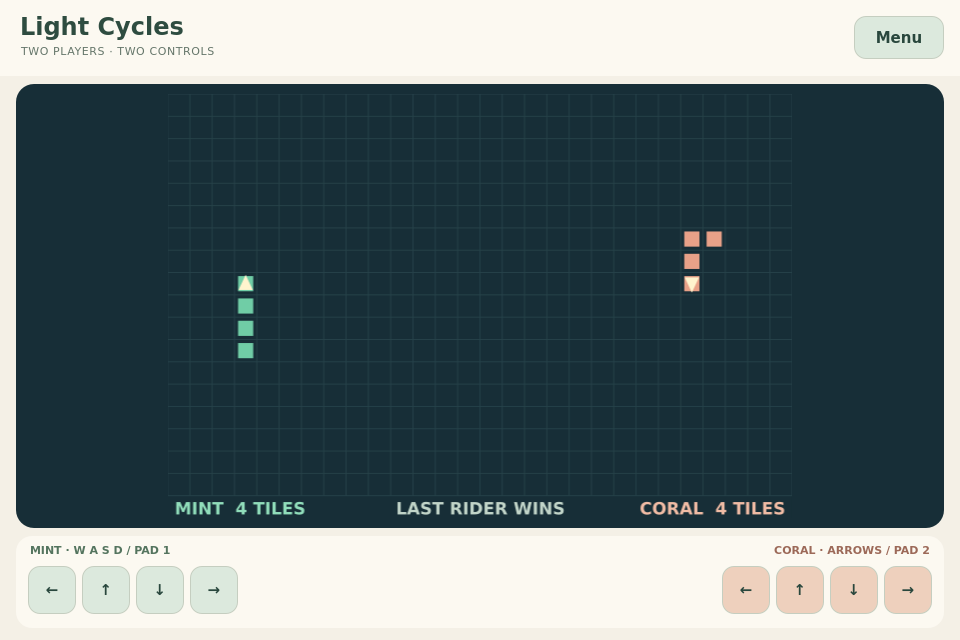

# Light Cycles

Two riders leave permanent walls. Turn into open space, trap your rival and
survive. Hitting a wall or any trail loses; simultaneous crashes draw.

Part of the [Competitive Mini-Games](../) collection for TrainerOS.

**Status:** [0.1.0 experimental release](https://github.com/EriArk/crates/releases/tag/light-cycles-v0.1.0)
for Linux x86_64/ARM64, installed through Crates on Odin/Flip. Bot match result and
Home/Exit checked remotely on Flip; physical controls and live internet acceptance pending.

## Play

Choose **Practice with bot**, **Two on this device**, or **Play with a friend**.
Turn with four directions; direct reversal is disallowed. Couch players use
WASD and arrows, two controllers, or their separate touch controls. Back opens
the leave confirmation. Local play pauses for the menu; online play continues.

For friend play, both open Light Cycles and use TrainerOS **GameHub → Lobby**,
select the game, prepare, both Ready, then organizer Start. Both players must
request a rematch. Exit or disconnection ends the round, preserving the room;
rejoin starts fresh. No game state is saved.

## Shared integration

[Build, packaging, controls and SDK contract](../arcade-common/README.md).
The organizer computes simultaneous movement and sends snapshots through the
existing SDK. Guest turns depend on network latency. Live internet play and
physical controls remain unverified; this is not competitive-ranking certification.

This version supports two players. The original 4–8-player idea and the
[wider community/ranking plans](../docs/shared-approach.md) remain future work.
Original code and vector/canvas art: [GPL-3.0-or-later](LICENSE).

See [idea notes](docs/idea.md).
