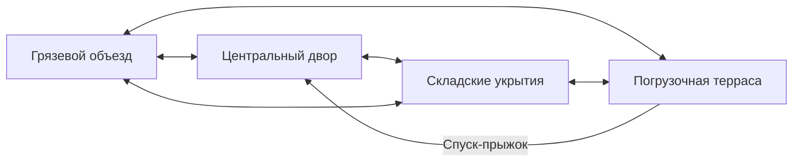

# Micro Rally — первая арена: Rust Pit

28 октября 2026. **Rust Pit реализована в исходниках и серверных сборках.**
Quick Play → Arena battle открывает отдельный бой; организатор существующего
лобби выбирает Racing или Rust Pit. Протокол игры — `micro-rally.6`.
[Проверки, кадры, снимки исходников и границы приёмки](evidence/arena-2026-10-28/README.md).

Первоначальное исследование выполнено на `7524838`; проект ниже сохраняется
как обоснование. Текущее поведение и отличия от предложений описаны здесь:

- Восемь минут, до 16 машин, 3 очка за уничтожение, 1 за значимую помощь,
  −1 за самостоятельное уничтожение. Общие места при полном равенстве.
- Возрождение через три секунды и две секунды защиты без стрельбы/подборов/
  столкновения с другими машинами. Возврат застрявшего/перевёрнутого автомобиля
  выбирает ближайший свободный узел и не ремонтирует здоровье/колёса.
- Пулемёт с перегревом; дополнительный слот ракет (3 выстрела) или импульса
  (2); отдельные щит, ремонт и охлаждение. RB/мышь — огонь, крестовина/Q —
  переключение слота. Ракеты проверяют весь отрезок перемещения; стены
  блокируют взрывной урон, импульс и помощь прицелу.
- Off/Low/Normal: ограниченная угловая доводка и наведение по высоте.
  Контроллер по умолчанию Low, мышь без боковой доводки. Отдельного замедления
  стика и удержания выбранной цели между выстрелами сейчас нет.
- Свободная навигация по 133 связанным узлам, выбор противника/предмета,
  приоритет ремонта при низком здоровье, обход/отход и выезд задним ходом.
  Настройки сложности и обычная физика общие с игрой.
- Восемь контейнерных укрытий, резервуары, терраса с боковыми рампами,
  бетон/гравий/грунт, промышленный ориентир и внешний ландшафт. Окружение
  статическое; новых физических обломков/сбиваемого реквизита в первом наборе нет.
  Промышленная геометрия собственная, растительность/камни — прежние Kenney CC0.
  Упомянутый ниже City Kit остаётся кандидатом, он не импортирован.
- Отдельные результаты арены не записывают фиктивные круги/финиш в карьеру.
  Woodland Challenge и его сохранения сохранены; новый боевой кубок не добавлен.

Владелец попросил одну арену с идеями Twisted Metal и Carmageddon, затем
добавил небольшую помощь в прицеливании. Первый боевой блок теперь идёт
перед сетевым кубком. Публикация, установка и портативная приёмка отложены.

## Что взято из исследования

Источники проверены 28 октября 2026. Разные выпуски указаны явно;
описания исторических сетевых режимов не означают доступность их серверов сегодня.

| Первичный источник | Наблюдение | Решение для Micro Rally |
| --- | --- | --- |
| [Оригинальный Twisted Metal — руководство Sony, с. 2–4](https://secure.cdn.us.playstation.com/manuals/classic/games/twisted-metal-manual-en.pdf) | Свободные боевые пространства, точки восстановления, бесконечный пулемёт с перегревом, расходуемое оружие и средства ухода от погони. | Сохраняем базовый пулемёт; сильные предметы заставляют перемещаться. Карта получает несколько связанных маршрутов и позиции для атаки/отхода. |
| [Twisted Metal 2012 — продюсер Chad Cox](https://blog.playstation.com/2012/01/31/twisted-metal-multiplayer-demo-coming-to-psn-today/) | В демо были свободный Death Match и командный Nuke, машины имели собственное специальное оружие. | Сначала один понятный бой всех против всех. Командные цели и уникальные способности машин не обязательны для первой арены. |
| [Twisted Metal 2012 — David Jaffe о карте Нью-Йорка](https://blog.playstation.com/2011/06/06/twisted-metal-at-e3-2011-iron-maiden-nyc-chaos-and-more/) | Обычная узнаваемая среда становится боевой площадкой с альтернативными проходами и опасностями окружения. | Промышленный карьер с понятными ориентирами. Высота и объезды меняют тактику; огромную разрушаемую городскую сцену не переносим. |
| [Carmageddon: Max Damage — официальное руководство, The Cars / PowerUps / Event Types](https://dlassets-ssl.xboxlive.com/public/content/f4fb8ed7-4be3-4344-b273-a8c56bfcea91/GameManual/6bdfb850-d276-4028-9c57-6e19a108761d/en-NZ/index.html) | Тараны, усиление столкновений, ремонт и восстановление машины; Car Crusher считает уничтожения. Fox ’N’ Hounds требует двигаться, чтобы зарабатывать время. | Удар и вытеснение становятся полноценными атаками. Нужны быстрый возврат в бой и причины менять позицию. Подвижную цель сохраняем как идею будущего события, не добавляем четвёртую категорию режима. |

Это собственная компоновка и правила игры. Первые предложения ниже — выводы
для нашей камеры, физики и управления, а не утверждения о правилах оригиналов.

## Место и компоновка

Рабочее английское название — **Rust Pit**: старый карьер с площадкой
переработки металла. Серый бетон, ржавые конструкции, жёлтые ограждения,
зелёные заросшие края и яркие машины. Сохраняем насыщенность эталона,
свет, тени и мягкий tilt-shift. Первый вариант — ясный день;
контракт погоды/времени суток остаётся общим.

Игровая область ориентировочно 180 × 150 м. Это стартовый масштаб для
максимума 16 машин; размер уточняется по времени встречи и свободе манёвра.
Цель — увидеть бой вскоре после появления, но успевать выйти из-под огня.
Узкие рабочие проезды должны позволять разминуться и развернуться.

- **Центральный двор:** бетон, низкие бетонные блоки и островки металлолома.
  Самый быстрый путь через карту и заметный мощный предмет в открытом месте.
  Укрытия разбивают прострел, не образуя лабиринт из тесных коридоров.
- **Грязевой объезд:** широкий путь вдоль края, лужи и гравийные ответвления.
  Позволяет набрать скорость для тарана, уйти от преследования и зайти с фланга.
- **Погрузочная терраса:** полка на 3–4 м выше двора, два широких заезда,
  низкие укрытия и спуск-прыжок в центр. С неё видно больше, но атаковать её
  можно с двух сторон. Ремонт и лучшие боеприпасы здесь не совмещаем.
- **Открытый складской двор:** несколько контейнерных островков и два
  разнесённых пункта ремонта. У каждой зоны боя минимум два выхода.
- **Ориентир:** неподвижный кран/дробильная установка у границы. Крупные
  конструкции не закрывают машину камере. Закрытых ангаров и обязательных
  поездок под крышей в первой карте нет.

Схема связности, не геометрический план и не скриншот игры:

Физические поверхности делаются крупными гладкими участками. Швы,
ступеньки и отдельные мелкие коллайдеры не должны цеплять колёса.
Мелкий визуальный мусор не получает твёрдый коллайдер. Первое окружение
преимущественно статическое; несколько лёгких сбиваемых объектов имеют
жёсткий бюджет и не заваливают основной проезд после каждого столкновения.
Кузова сохраняют текущие повреждения/грязь и потерю колеса без распада на части.

Кандидат для окружения: [Kenney City Kit (Industrial)](https://kenney.nl/assets/city-kit-industrial).
Страница автора указывает CC0. Пакет пока не скачан и не интегрирован;
при импорте сохранить файл лицензии и происхождение выбранных моделей.
Масштаб, палитра и простые коллайдеры должны соответствовать существующим машинам.

## Первый игровой набор

**Arena battle / Free-for-all**, до 16 машин, одиночная игра с настраиваемыми
ботами и сетевая через существующее лобби TrainerOS. Продолжительность
предлагается 8 минут, с возрождениями. Уничтожение не выводит игрока из матча;
выбывание относится к отдельному Battle royale.

Начальная формула: 3 очка за уничтожение, 1 за значимую помощь,
минус 1 за самостоятельное уничтожение. Обычная смерть от соперника
не отнимает очки. Помощь получает один другой участник, нанёсший наибольший
урон из подходящих: минимум 30 здоровья за последние 8 секунд.
Урон щиту и избыточный урон не накапливают помощь. После ремонта учитывается
только ещё не восстановленный вклад; после возрождения журнал очищается.

Хост начисляет уничтожение один раз на жизнь. Если машину вытолкнули в
опасность, проверяется недавний физический контакт атакующего; самостоятельное
восстановление не должно стирать заслуженное уничтожение. При равных очках
сравниваются уничтожения, затем меньшее число смертей; полное равенство
сохраняет одинаковое место. Slot нужен лишь для стабильного порядка отображения.

Возрождение ориентировочно через 3 секунды. Точка выбирается по свободному
месту, расстоянию и видимости противников, без прямого выхода под их огонь.
Короткая защита не позволяет стрелять, таранить или собирать ресурсы;
после её завершения машина возвращается в обычные коллизии только в свободной
позиции. При занятости всех точек повторяется безопасный поиск, а не наложение
кузовов. Переворот исправляется рядом с безопасной опорой и не лечит машину.

В первом наборе достаточно:

- текущего бесконечного пулемёта с перегревом;
- ограниченного запаса прямых ракет с небольшим радиусом взрыва;
- импульсного удара для близкого боя и срыва преследования;
- щита, охлаждения и ремонта как раздельных предметов с восстановлением точек.

Ракетам нужны время полёта и читаемый след, импульсу — заметная дистанция
действия. Бонусы не дают постоянного улучшения машины. Не вводим одновременно
большой арсенал, заморозку, масляные поля, мины и сложное разрушение окружения.
Это резерв расширения после первого проверенного боя.

Базовое управление сохраняется. RB стреляет выбранным оружием; крестовина
переключает пулемёт и один дополнительный слот. Пустой слот возвращает пулемёт.
Правый стик отвечает за прицел, левый — за руль; газ/тормоз, ручник, щит,
ускорение и ручные передачи сохраняют свои действия. Переназначения и подсказки
должны охватывать контроллер/клавиатуру и не конфликтовать с меню.

## Небольшая помощь в прицеливании

Уточнение владельца: помощь нужна. Предлагаются **Off / Low / Normal**,
по умолчанию **Low** для контроллера; мышь по умолчанию без доводки.
Численные настройки требуют проверки ощущения и не считаются принятыми.

- Захват только возле направления, которое задаёт игрок, внутри дальности
  оружия. Начальный конус Low — около 5°, Normal — около 8°.
- Плавная ограниченная доводка, без мгновенного разворота оружия и автоматического
  огня. Явное движение стика от цели немедленно прекращает сопровождение.
- Стабильный выбор между близкими кандидатами: не дёргать прицел каждый кадр.
  Мёртвые/возрождающиеся машины не цели. Укрытие разрывает сопровождение;
  линия выстрела проверяется от ствола, включая землю и края террас.
- Общий решатель наведения должен учитывать высоту: нынешний горизонтальный
  луч нельзя просто перенести на многоуровневую карту. Off отключает боковую
  доводку к машине, а не превращает наведение снова в плоскую стрельбу:
  точка прицела и пересечение мира всё равно трёхмерные.
- Для ракет доводка не означает самонаведение после выстрела или гарантированное
  попадание в движущуюся цель. Ограничения дальности/углов применяет хост;
  клиент не присылает доверенное попадание, урон или идентификатор жертвы.
- Боты используют свои уже заданные реакцию/точность, а не получают дополнительную
  помощь поверх них. Настройка сложности не меняет здоровье и физику человека.

## Что действительно есть в коде

| Узел на `7524838` | Можно использовать | Требуется для арены |
| --- | --- | --- |
| `vehicle_physics.gd`, `tire_surface.gd` | Подвеска, контакт четырёх колёс, пять покрытий, влажность, заносы и прыжки. | Поверхности новой сцены и проверка стыков/рамп, без второй модели физики. |
| `car.gd` | Здоровье, щит, нагрев, повреждение колеса, эффекты состояния. | Отделить круги/чекпойнты от общего автомобиля; события урона с автором/причиной и номером жизни. Сейчас контакт повреждает без автора. |
| `main.gd` | Отсчёт, управление, камера, эффекты, звук, существующее лобби. | Отдельные правила боя/возрождения/итогов. Сейчас `tick`, возврат и завершение требуют замкнутую трассу; `_shoot` стреляет горизонтальным лучом без учёта автора результата. |
| `bot_driver.gd` | Реакция, стили, точность, видимость, охлаждение и обычные управляющие команды. | Свободная навигация, выбор цели/предмета, отход и обход укрытий вместо следования `track.points`. |
| `race_session.gd`, `race_wire.gd` | Хост считает мир; клиенты отправляют ввод; SDK задаёт участников. | Версия протокола с mode/map/rules, счётом, жизнью/возрождением, предметами и снарядами. Сейчас prepare фиксирует трассу и 4 круга. |
| `cup_rules.gd`, `event_catalog.gd` | Главное меню, каталог и общий замысел кубков разных типов. | Результат события должен иметь тип; арена не выдаёт фиктивные круги/время финиша. Доступность переключается только с рабочим запуском. |

Отдельный `ArenaRules` владеет очками/временем/жизнями; сцена арены — точками
появления, поверхностями и графом проездов; `ArenaBot` — решениями движения.
Общие автомобиль, ввод, урон, звук, SDK и камера переиспользуются.
Гонки не должны обзавестись неявными условиями «нулевое число кругов значит бой».

Боты выбирают «атаковать / зайти сбоку / взять ресурс / уйти / выбраться».
Граф проездов учитывает ширину, радиус поворота и направленные прыжки;
короткий локальный прогноз проверяет стену и соседние машины. Пересчёт целей
распределяется по времени между 16 участниками. Нельзя направлять автомобиль
по пешеходному пути с невозможным поворотом или менять его transform ради погони.

## Входы, кубки и сеть

- Main menu → Quick Play → Arena battle → Rust Pit → сложность/состав/условия
  → бой → таблица очков → реванш либо обратно к выбору события.
- Lobby → общий дескриптор события → подтверждение загрузки всеми → общий
  отсчёт → авторитетный бой → одна таблица → реванш или возврат в то же лобби.
  Никаких новых комнат/аккаунтов. Существующий отказ при выходе участника
  сохраняется до отдельной реализации восстановления сеанса.
- HUD: место/очки/таймер в углу, компактные сообщения об уничтожениях,
  оружие/нагрев, здоровье/щит и прежний аватар справа внизу. Без полос,
  отнимающих верх/низ экрана. Интерфейс полностью английский.
- Кубки остаются основной прогрессией. Арена получает типизированный результат
  места, который позднее переводится в стандартные очки этапа; сырые очки боя
  не складываются с временем/уроном гонки. Первый Woodland Challenge и его
  сохранения не меняются; новые боевые/смешанные кубки формируются отдельно.
  Одиночная быстрая арена сама по себе не открывает машину за победу в кубке.

## Исполнение и приёмка

ARENA-01–03 реализованы. Для ARENA-04 выполнены серверные проверки,
перечисленные в отчёте выше; физическое управление и сетевые устройства
остаются ARENA-05. Список ниже сохраняет границы каждого блока.

1. **ARENA-01 — среда и свободное вождение:** модуль карты, связные проезды,
   поверхности, рампы, камера и безопасный возврат. Результат — объезжаемая
   арена без привязки к гоночным кругам; это ещё не завершённый боевой режим.
2. **ARENA-02 — полный одиночный бой:** правила, урон/зачёт/возрождение,
   небольшой арсенал, помощь прицеливанию, боты, меню/HUD/результаты/реванш.
3. **ARENA-03 — существующее лобби:** новый проверяемый игровой контракт,
   общая подготовка/счёт/предметы/итоги, повторный бой и выход. Неподдерживаемые
   версии/карты отклоняются; протокол SDK и инфраструктура не переписываются.
4. **ARENA-04 — проверка целого пути:** два клиента и полный матч с 16 машинами,
   рампы/укрытия/тараны, стабильность ботов, ввод после меню, результаты/реванш.
   Проверить повторные события, смерть от второго потерянного колеса,
   самоурон, сброс с террасы, ремонт и возрождение без двойного начисления.
   Для помощи проверить срыв за укрытием, высоту, границу конуса, отпускание
   цели стиком, выключение и одинаковые ограничения хоста/клиента.
5. **ARENA-05 — разрешённая позже приёмка:** портативные управление/прицел,
   читаемость и время кадра при 16 машинах, полный сетевой бой между устройствами,
   публикация/установка. Серверный рендер и headless не доказывают эти пункты.

Декор батчируется, число активных снарядов/физических обломков/источников звука
ограничивается; повреждающие события считает хост, косметику воспроизводит клиент.
Бюджеты уточняются по профилю боя с максимальным составом, не по пустой карте.
16 машин — требуемая вместимость, **не подтверждённые FPS**.

После этого блока сохраняется очередь сетевого кубка, церемонии наград и
непрерывного четырёхэтапного пути. Конкретные составы новых кубков и режим
Battle royale этим исследованием не реализованы.
