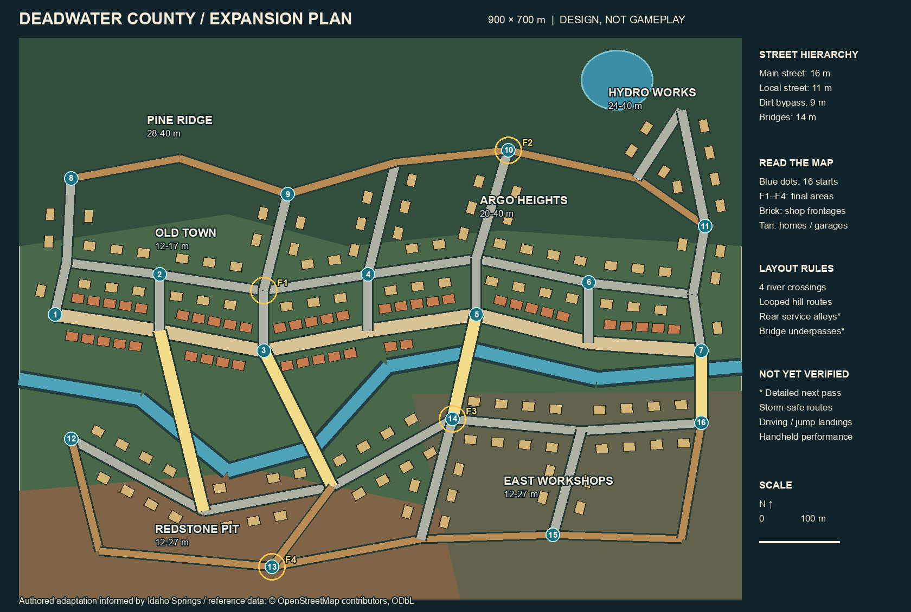

# Deadwater County — план увеличения и реальная основа

28 октября 2026. Владелец запросил более просторную карту и правдоподобные улицы/
типы домов на основе настоящего места. Этот проход готовит **план перед новой
геометрией**. В игре по-прежнему версия карты 360×360 м из `b54029a`.



[Географическая подложка Idaho Springs](reference.png) отдельно показывает реальные
улицы и контуры зданий. План выше — авторская игровая адаптация, не точная копия
и не автоматическая конвертация города. Цветовые зоны обозначают характер
территории, а не измеренные горизонтали. Условные прямоугольники — места застройки,
не готовые модели и не точные границы участков.

## Что берём из настоящего места

- Вытянутую структуру долины: Miner Street, параллельную High Street, короткие
  поперечные авеню, отдельный Riverside Drive и подъём Virginia Canyon Road.
- Центральные фасады вдоль улицы, компактные кварталы и хозяйственные переулки;
  на склонах — более редкую индивидуальную застройку.
- Кирпичные торговые здания Miner Street: источник —
  [официальный туристический сайт](https://www.visitidahospringsco.com/historicminerstreet).
- Горнопромышленный ориентир Argo: источник —
  [Historical Society of Idaho Springs](https://historicidahosprings.com/historic-sites/argo-mill-and-tunnel/).

Обходы, четыре переправы, карьер, водохранилище/плотина и положение финальных
площадок придуманы для Deadwater. Высоты — проектные игровые, не геоданные.
Скоростную автомагистраль I-70 в игровой центр не переносим: её роль берёт на
себя более медленный южный служебный маршрут с перекрёстками и укрытиями.
Фотографии используются для изучения, в пакете игры их нет.

## Масштаб и темп

900×700 м, 0,63 км², в 4,86 раза больше нынешней площади. Масштаб машины прежний.
16 стартов, расстояние между ближайшими центрами — 90 м; в геометрии потребуется
разнести их обзоры зданиями/поворотами. Одна жизнь и существующие оружие/подборы
сохраняются; увеличение площади само по себе не гарантирует 10–12 минут боя.

| Проверяемый переезд | Длина по схеме | Расчёт при средней скорости 10–18 м/с |
|---|---:|---:|
| Запад → восток центральной улицы | 817 м | 45–82 с |
| Северо-запад → юго-восточная окраина | 1204 м | 67–120 с |
| Гидроузел → юго-западный карьерный путь | 1125 м | 62–112 с |
| Центр → мастерские | 363 м | 20–36 с |

Это деление расстояния на **предполагаемую среднюю** скорость, не замер машины:
ускорение, заносы, стрельба, остановки и столкновения пока не симулировались.
Граф имеет 33 узла и 50 связей. Он связен и остаётся связным после исключения
любой одной из четырёх переправ. Максимальный уклон между концами отрезка 11,43%;
сглаживание и переходы уклонов ещё требуют проверки настоящими колёсами.
[Воспроизводимые числа](route-estimates.json).

## Застройка: набор вместо одинаковых домиков

Планируемые габариты ниже — игровые ориентиры, не размеры реальных зданий.
Разнообразие создают геометрия, высота, посадка на участок и назначение фасада.

| Модуль | Ориентир размеров | Посадка и характер |
|---|---|---|
| Рядовой магазин | 8–12×14–20 м, 2 этажа | Фасад к тротуару, витрина, парапет, задняя дверь |
| Угловой магазин/бывший банк | 16×20 м, 2–3 этажа | Два уличных фасада, скос угла, небольшой двор |
| Дом на склоне | 10×14 м, 1–2 этажа | Крыльцо, двухскатная крыша, ступенчатый цоколь |
| Жилой дуплекс | 16×12 м, 2 этажа | Парные входы, боковой проезд, общий задний участок |
| Гараж/сарай | 6×8 м | При доме или заднем переулке, отдельная крыша |
| Автомастерская | 24×20 м | Несколько ворот, открытая площадка, боковой обход |
| Склад | 30×24 м | Погрузочная сторона, навес, простая крупная крыша |
| Фабрика на террасах | Сборка из нескольких объёмов | Ступени по склону, высокий ориентир, нижний проезд |

Old Town получает плотные торговые фронты; Pine Ridge — дома/гаражи и лесные
просветы; Argo Heights — террасную фабрику и редкую жилую застройку; East Workshops
— крупные объёмы и рабочие дворы; Redstone Pit — минимум домов и промышленные
сооружения. Hydro Works — отдельная придуманная плотина/служебный комплекс.

На следующем геометрическом проходе задние переулки шириной 6–8 м соединяют
минимум две улицы; тупиковые декоративные дворы не содержат обязательных подборов.
Ширина главной дороги 16 м, местной 11 м, грунтовой 9 м, мостового проезда 14 м.
Углы центральных улиц сохраняют узнаваемые кварталы; подходы/подъёмы закругляются.
Высокие крыши у камеры должны скрываться, не меняя физических стен.

## Мосты, фронт и следующие проверки

Четыре золотых коридора на схеме — **переправа вместе с подходами**, не сплошной
длинный настил. Настил строится только над водой/нижней дорогой. Для нижних
проездов нужны отдельные узлы по высоте, минимум 5 м просвета и проверка подъездов.
На нынешней схеме нижние проезды и детальные переулки ещё не нарисованы и не
участвуют в расчёте связности.

F1–F4 — кандидаты, не утверждённые безопасные круги: центральный квартал,
верхняя фабричная площадка, мастерские и карьерный двор. Начальный радиус текущей
карты 280 м слишком мал; для поля 900×700 м нужен начальный охват не меньше
570,1 м от центра, рабочий ориентир 600 м. Расписание/смещение следующих кругов
настроить по новым путям, сохраняя вложенность. Нельзя переносить прежние финалы
простым масштабированием.

Очередь реализации, до возврата к сетевому кубку:

1. Новая высотная геометрия по этому плану, кривые улицы, физические мосты/
   нижние проезды и маршруты ботов. Сначала простые объёмы зданий.
2. Проверки 16 стартов, ширины поворотов, переездов и поиска пути; связность
   доступной зоны на всех стадиях, возможность доехать до неё до фронта.
3. Модули зданий/участков и районный декор. Разбить окружение на участки,
   объединять повторяющиеся детали, упрощать дальние здания; физику машин сохранять.
4. Полные бои с обычным уроном: время первого контакта, длительность, гибель
   от зоны, застревания и доля времени без противника. По ним менять фронт/подборы,
   а не обещать длительность исходя только из площади.
5. Серверные визуальные/сетевые проверки. Портативные FPS, управление, установка
   и публикация остаются отложенными до нового разрешения владельца.

План не закрывает прежнее предупреждение о ресурсах при выходе графической
сессии. Нового билда игры, новых кубковых наград и смены протокола в этом проходе нет.

## Источники, лицензия и воспроизведение

`idaho-springs-reference.json` — сохранённая выборка геометрии/нескольких тегов
1347 объектов OSM; ID и время исходного снимка сохранены. Источник: Overpass,
границы юг/запад/север/восток `39.737,-105.528,39.750,-105.500`. Запрос:

```text
[out:json][timeout:25];
(way["highway"](39.737,-105.528,39.750,-105.500);
 way["building"](39.737,-105.528,39.750,-105.500);
 way["waterway"](39.737,-105.528,39.750,-105.500););
out geom;
```

© OpenStreetMap contributors. Выборка и данные адаптированного плана `layout.json`
предоставлены под [ODbL 1.0](https://opendatacommons.org/licenses/odbl/1-0/).
Это отдельная граница лицензии данных, не смена лицензии кода игры.
[Условия OSM](https://www.openstreetmap.org/copyright),
[указание авторства в играх](https://osmfoundation.org/wiki/Attribution_Guidelines#Computer_games_and_simulations).
Подложка не содержит снимков спутника или заимствованных игровых моделей.

Из корня репозитория: `py -3.12 games/competitive-minigames/micro-rally/tools/plan_deadwater.py`.
Требуется Pillow; сеть не используется. Скрипт строит две схемы и расчёты из
сохранённых данных. На этом проходе исполнен успешно; схемы просмотрены визуально.
