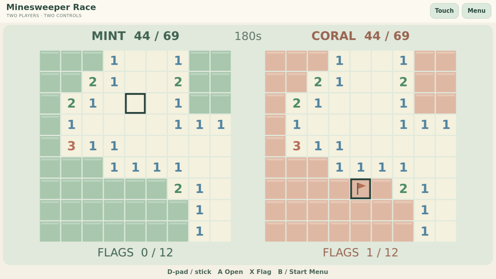

# Minesweeper Race

**Prepared update (not published):** 0.1.1 improves controller input, field size and effects.
[Repair details and acceptance boundary](../docs/controls-and-presentation.md).

Race to open the safe squares on identical minefields.



## Play

- **Practice with bot**: offline solo practice.
- **Two on this device**: simultaneous independent Mint/Coral controls.
- **Play with a friend**: the existing TrainerOS GameHub Lobby and SDK record channel,
  with mutual rematch and room-preserving exit/rejoin. See [the shared journey](../arcade-common/README.md).

Each 9×9 board has 12 mines. The centre and its neighbours are safe, and the same
initial flood is opened for both players. **Open** reveals a square; **Flag** toggles
a marker. Opening a numbered square with the matching number of adjacent flags
opens its remaining neighbours (incorrect flags can trigger a mine). A mine loses.
First to open all 69 safe squares wins; after three minutes, most safe squares wins.
Simultaneous wins/losses draw. Flags alone do not score.

The practice bot uses visible numbers and flags, with guesses when deduction fails.
Boards are not guaranteed solvable without guessing. Online peers share the seed;
this is casual friend play, not hidden-map anti-cheat. Daily/weekly challenges and
rankings remain future work.

## Controls

| Input | Move | First action | Second action |
| --- | --- | --- | --- |
| Solo / online keyboard | Arrows or WASD | Enter, Space or F | Shift or G |
| Local Mint | WASD | F or Space | G |
| Local Coral | Arrows | Enter | Shift |
| Each controller | D-pad | SDL Confirm (A mapping) | SDL X mapping |
| Touch | Visible arrows | Labelled action button | Labelled action button |

Back/Escape or controller Back/Start opens the exit confirmation. Offline play
pauses when focus is lost; online play continues with held directions released.
Actions are discrete: holding an action does not repeat it. Directions repeat on
the simulation clock. Local controller 1 owns Mint, controller 2 owns Coral;
online controller 1 owns the local seat. Physical glyph adaptation belongs to the
shared controller follow-up and is not claimed here.

## Build and preparation

```sh
cmake -S games/competitive-minigames -B build/puzzles -DCMAKE_BUILD_TYPE=Release -DARCADE_GAMES=minesweeper-race
cmake --build build/puzzles --parallel 3
./build/puzzles/minesweeper-race --windowed
python3 games/competitive-minigames/arcade-common/package.py minesweeper-race build/puzzles/minesweeper-race dist/minesweeper-race
```

C++20, Qt 6.4+ Quick/Network and SDL2. Original code and SVG/Canvas artwork are
GPL-3.0-or-later; [LICENSE](LICENSE). The complete source archive includes all shared
rule implementations needed by the suite. [Preparation and verification](../docs/puzzle-trio-preparation.md)
separates desktop evidence from the main chat's publication, ARM and device work.
This game is prepared for Experimental 0.1.0; this document does not announce a release.

The [original concept](docs/idea.md) is retained as history. Common community/social,
ranked and tournament ideas are not implemented by this package.
