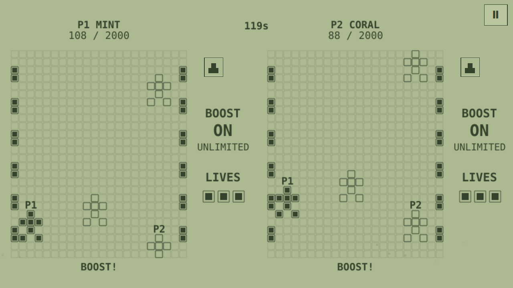

# Brick Racing

**Prepared handheld update 0.1.3:** bounded painting resolution, height-scaled HUD and larger game menus.
[Changes, checks and delivery limits](../docs/handheld-repair.md).


Shared-road racing on a monochrome block display.



## Multiplayer design

Both drivers occupy **one road and one generated obstacle course**. Two scrolling
views keep each player's car visible even after an accident; the rival in either
view is the same live car, not a ghost or an independent race.

- Left/right changes lanes; Up accelerates, Down brakes.
- **Boost** toggles on/off with a tap and has unlimited energy. It stays selected
  through recovery; Down brakes even with boost enabled. There are **five lanes**.
- A car behind another is limited by its speed until it passes. Side changes
  cannot overlap the rival; crashing cars become passable during recovery.
- Each driver starts with **three lives**. An obstacle removes one life and stops
  the car for **0.6 seconds**. Losing the last life loses the race; simultaneous
  elimination draws. The same gate cannot remove another life during recovery.
- First to 2000 distance units wins. When both cross in the same tick, the fraction
  of the final movement decides; exact equality draws. After two minutes, the
  greater distance wins. Rematch generates a new shared course.

A training bot follows the same visible road and uses the same controls. No
rubber-band teleporting, weapons, ranked results or automatic reward submission.

## Modes and controls

**Two on this device** uses simultaneous independent controls. Online play starts
from the existing TrainerOS Lobby/SDK channel, using **mini-racing.3** on both ends. Both players must
agree to an online rematch. Exit ends the round and keeps the Lobby; rejoin starts
a fresh round. **Practice with bot** remains available for learning the controls.

| Player / input | Directions | Boost |
| --- | --- | --- |
| Local Mint / P1 | WASD | F or Space |
| Local Coral / P2 | Arrows | Enter |
| Solo or online | Arrows or WASD | Enter, Space or F |
| Each controller | D-pad | SDL Confirm / A mapping |
| Touch | Labelled arrows | Visible Boost button |

Back/Escape or controller Back/Start opens the exit confirmation. Local play pauses
on focus loss; an online match continues with held directions released. Actions
are discrete taps. P1 uses solid LCD blocks and P2 outlines. These fixed labels do
not claim physical device-specific controller glyph support.

## Build and package

```sh
cmake -S games/competitive-minigames -B build/brick -DCMAKE_BUILD_TYPE=Release -DARCADE_GAMES=mini-racing
cmake --build build/brick --parallel 3
./build/brick/mini-racing --windowed
python3 games/competitive-minigames/arcade-common/package.py mini-racing build/brick/mini-racing dist/mini-racing
```

C++20, Qt 6.4+ Quick/Network and SDL2. Original SVG/Canvas art and code are
GPL-3.0-or-later; [LICENSE](LICENSE). No borrowed ROMs, sprites or sounds.
Experimental preparation 0.1.3; publication and device acceptance belong to the
main workflow. [Preparation handoff](../docs/brick-duo-preparation.md) records scope
and checks; [shared integration](../arcade-common/README.md) documents SDK limits.
The [initial concept](docs/idea.md) remains as history.
