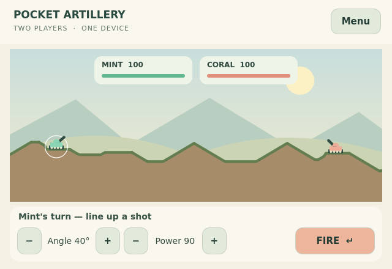

# Pocket Artillery

A two-player artillery duel: aim, set the power and fire across destructible hills.
Shells carve craters; explosions and falls damage the tanks. The last surviving
tank wins. A round ends in a draw after 60 shots if both tanks survive.

**0.1.3** adds the installed Lobby declaration and automatic SDK attachment after
the first frame. Online matches launch from TrainerOS Lobby; registration alone
keeps the solo menu open. Version 0.1.2 added close aiming, a whole-flight camera,
impact focus and immediate damage feedback on top of the 0.1.1 controller repair. See the
[Pocket Artillery review and handoff](docs/presentation-pass.md).



## Play

- **Play on one device:** pass the controls between Mint and Coral. Each player
  confirms the handoff before aiming. This mode works without TrainerOS or an account.
- **Online:** install the game on both devices. In TrainerOS **GameHub → Lobby**,
  create/join the usual room, select Pocket Artillery, prepare, mark both players
  Ready, then the organizer presses Start. TrainerOS launches both games. Invitations
  and membership belong to TrainerOS; the game does not create a second room system.
- Left/right changes angle; up/down changes power. Confirm/Enter/Space fires.
  Back/Escape or Start opens the leave confirmation. The D-pad or left stick aims;
  hold a direction to repeat adjustments. Touch restores the optional screen controls;
  hardware input hides them. SDL2 handles connected controllers while Qt has focus.
- X (Xbox layout), the displayed secondary controller button, Tab, or a tap on the
  minimap switches between close aiming and the whole field. Angle and power remain
  visible in either view. Flight automatically shows the arc, then focuses the impact.
- Recoil, muzzle smoke, flying dirt, a brief hit flash and floating damage accompany
  each shot. Terrain and health update at impact, followed by about one second to
  read the result before the next handoff. Effects do not change the integer rules.
- After the result, **Play again** creates new terrain and alternates the starting
  player. In a friend duel, both players must request the rematch.
- Leaving or losing a connection ends the round, preserving persistent Lobby
  membership. Join again, prepare, Ready and Start for a fresh duel. Interrupted
  rounds are not restored, and disconnects do not award a victory.

Angle and power change in five-unit steps. There is no bot opponent, ranked score
submission, currency, tournament or persistent match history in this first version.
The wider [collection plans](../docs/shared-approach.md) remain targets.

## TrainerOS integration

Optional Platform SDK v1 capabilities: `lobby.activity: 1` and `network.records: 1`.
App ID: `art.abysstail.pocket-artillery`; game protocol: `pocket-artillery.2`.
Version 0.1.1 introduced enlarged tanks with matching hit areas; the older `.1`
rules cannot share this match. Version 0.1.2 retains the `.2` protocol and rules.
See the [SDK network contract](https://github.com/EriArk/TrainerOS/blob/codex/platform-sdk-foundation/sdk/NETWORK.md).

The SDK discovers/authenticates the local host and supplies its existing two-peer
reliable ordered channel. The game exchanges round setup, shots and rematch votes;
it never asks the player for IP addresses or runs its own relay. Both games compute
integer physics and compare the pre/post-shot state digests. Wrong turns, invalid
records or divergent states end the match. These checks detect disagreement, not
cheating or eligibility for official rewards.

Profile changes and host/channel loss stop the online duel. Missing SDK support
returns to the menu with an explanation; local play remains available. The package
does not read emulator saves or private Social data. No game state is persisted.

The current SDK's transport/helper and communication-account requirements still
apply. Local TLS checks do not establish live Fluxer, different-network or difficult
NAT connectivity. There is no guaranteed seamless reconnection or universal internet
support. No additional owner-hosted media or game relay is required by this game.

## Build, test and package

Dependencies: C++20, CMake 3.24+, Qt 6.4+ Core/Gui/Qml/Quick/Network and SDL2.
Tests also need Qt Test. Linux needs the QtQuick/Window/WorkerScript QML runtime
modules. The package uses the host's Qt/SDL libraries.

```sh
cmake -S games/competitive-minigames/pocket-artillery -B build/pocket-artillery -DCMAKE_BUILD_TYPE=Release
cmake --build build/pocket-artillery --parallel 3
ctest --test-dir build/pocket-artillery --output-on-failure
./build/pocket-artillery/pocket-artillery --windowed
python3 games/competitive-minigames/pocket-artillery/package.py build/pocket-artillery/pocket-artillery dist/pocket-artillery
```

Windows development uses the TrainerOS UCRT64 Qt/SDL toolchain and `.exe` suffix.
`--endpoint PATH` selects isolated SDK discovery. `--screenshot PATH` captures the
actual window and exits. Default launch is fullscreen; `--windowed` is for desktop use.

For optional real-host tests, configure `TRAINEROS_SOURCE` to a matching TrainerOS
SDK checkout and `TRAINEROS_CORE` to its built `libtrainer_core.a`; this configuration
is supported by the Windows UCRT64 development setup. Set
`TRAINEROS_TEST_RECORD_PYTHON` to the SDK secure-helper virtual environment's Python.
The `artillery_host` test creates two real PlatformHosts and two game clients, using
separate TLS helper processes; only provider signaling is substituted locally.

`package.py` accepts a Linux ELF for x86_64 or aarch64 and produces the game archive,
matching source archive, installer record and SHA256SUMS. It does not cross-compile.
The package record is `Experimental` / `untested` pending device acceptance. A record
containing a future release URL does not publish that release or add it to the catalogue.
To check an actual package in disposable Linux storage:

```sh
python3 games/competitive-minigames/pocket-artillery/tests/verify_package.py TRAINEROS_CHECKOUT RECORD_JSON PACKAGE_TAR_GZ
```

Original code and vector/canvas artwork: GPL-3.0-or-later; see [LICENSE](LICENSE).
The [original idea](docs/idea.md) retains the wider concept.

## Verification — 21 October 2026

- Windows UCRT64 / Qt 6.11 and Linux x86_64 / Qt 6.4: rules, destructive winning
  shots, invalid-input rejection, missing/disconnected host fallback, QML health
  display, keyboard aiming, pointer firing and leave/cancel confirmation passed.
- The same fixed-seed rule sequence produced SHA256
  `317f2be64027c4b589715cc6ca2a7828d3eb0c460660fafb5b29e34ddd908865`
  on both builds, and subsequently on the ARM64 / Qt 6.11.2 build under QEMU.
  This is bounded evidence for that rule sequence, not internet gameplay acceptance.
- Windows real-host test: two game clients, two PlatformHosts and separate secure
  helper processes over loopback TLS; complete duel with equal state after every
  shot, mutual rematch/alternating starter, exit, retained room, rejoin and profile
  revocation passed. Out-of-turn shots and a forged post-shot digest on a valid
  remote turn end the duel without applying the invalid candidate state.
  The game clients run in the test process; this is not a two-device or live-provider check.
- Linux Release package: actual installation, launch, running-package removal
  protection, removal and data-preserving reinstall passed in disposable storage.
- Rendered menu and duel were inspected at 640×440, plus the desktop menu at
  960×600 logical pixels. Physical controllers/touch and ARM performance remain untested.
- Existing installed TrainerOS builds must not be assumed to include this SDK.
- ARM64 / Fedora 44 / Qt 6.11.2: Release build, rules/QML tests and real package
  install/launch/remove/reinstall passed under QEMU. The ARM package is added to
  the same 0.1.0 release with its own record and `SHA256SUMS-aarch64`, reusing the
  original source archive. Public catalogue revision 6 selected the correct build
  and completed the package cycle on both x86_64 and emulated ARM.
- Subsequently installed through normal Crates Download on Odin/Flip with the
  required shell/SDK. On Flip the actual local duel rendered, a shot caused damage
  and passed the turn, and system Home/Exit returned to Crates. Input was synthetic.
  Physical controls/sustained performance, live Fluxer invitation, paired internet/
  NAT acceptance and official scoring remain unverified or unfinished.
