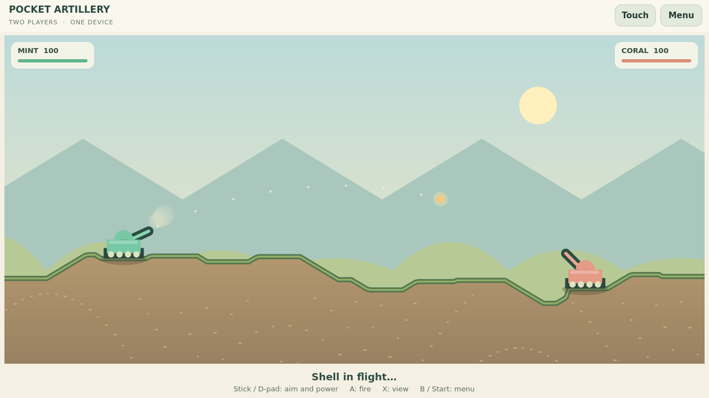

# Pocket Artillery — отдельная доработка 22 октября 2026

По решению владельца игры разбираются по одной. Этот проход затрагивает только
Pocket Artillery, поверх общего исправления `037bdd5`. Следующая игра — после
обсуждения результата этой; остальные восемь игр и общий SDL-обработчик не менялись.

## Игровой результат

- При наведении камера приближает свой танк; угол и мощность находятся рядом.
  Миникарта показывает положение обоих игроков. X для раскладки Xbox / указанная
  вторичная кнопка контроллера, Tab или касание миникарты переключают общий вид.
- При выстреле камера отъезжает, чтобы показать дугу, затем приближает попадание.
  Переход занимает 360 мс. Полёт сохраняет один шаг траектории за 24 мс;
  пауза после попадания увеличена с 576 до 1008 мс.
- Добавлены отдача, вспышка и дым у дула, след снаряда, ударное кольцо, летящая
  земля, дым попадания, вспышка корпуса и всплывающий урон. Корпус плавно опускается
  в воронку. Здоровье и рельеф меняются при ударе, ещё до экрана передачи хода.
- Удалён дублирующий нижний блок угла/мощности при аппаратном вводе; значения
  видны у танка либо компактно в общем виде. Сенсорное управление сохранено.
- Сетевая анимация использует угол и мощность полученного выстрела. Физика,
  попадания и протокол `pocket-artillery.2` не менялись.

## Проверки и границы

Windows UCRT64 / Qt 6.11.1 и Linux x86_64 / Qt 6.4.2: полный локальный матч через
виртуальное устройство SDL, наведение, переключение камеры, выстрелы, подтверждение
передачи хода, победа, реванш со сменой первого игрока, отмена и подтверждение выхода.
Тест выбирает угол по состоянию мира, но весь матч управляется настоящим игровым
SDL-обработчиком. Это автоматическая проверка, а не физический геймпад в руках.
Журналы: [Windows — 9 passed](evidence/windows-game.txt),
[Linux — 9 passed](evidence/linux-game.txt). После увеличения минимального размера
снаряда на экране и проверки Tab повторены затронутые сценарии камеры/ввода:
[Windows — 5 passed](evidence/windows-camera.txt),
[Linux — 5 passed](evidence/linux-camera.txt). Эти числа включают init/cleanup QtTest.

Проверены рамки камеры, панель наведения, обновление HP непосредственно при ударе,
маленький сенсорный экран 640×440 и высокая дуга при 80° / мощности 100. Снимки
наведения и попадания отдельно просмотрены на Windows и Linux. Полёт/танки/подписи
проверены в диапазоне 640×440–1280×720; аппаратная производительность остаётся открыта.

Windows SDK/TLS: две игры и два PlatformHost, полный матч с равными состояниями,
передача фактического угла/мощности, взаимный реванш, выход с сохранением Lobby,
повторный вход, смена профиля и отклонение неверных сетевых записей. Только provider
signaling заменён локальной связкой; реальные TLS-helper процессы работают через
loopback. Это не доказательство живого Fluxer или игры из разных сетей.
[Журнал SDK/TLS — 3 passed](evidence/windows-host.txt).

Сохранён прежний контрольный хеш правил для seed 12345:
`6534f5f61ae71f39dd8064083f7d0d82a3e758866812ad46bd8be68083c2431d`.

## Передача основному чату

Ветка `codex/artillery-camera-pass`, отдельная рабочая копия
`D:\Projects\Crates-artillery`. Версия подготовки — **0.1.2**.
После фиксации исходников `package.py` формирует Linux x86_64 архив, полный архив
исходников с общим SDL-заголовком, installer record и SHA256SUMS в
`dist/prepared-pocket-artillery`. Запись остаётся `Experimental` / `untested`.
Итог проверки именно этих архивов записывается в корневом `PROJECT_STATUS.md`.

Публикация, ARM64-сборка, обычное обновление через Crates на Odin/Flip и физическая
приёмка принадлежат основному чату. Этот проход не устанавливает игру на устройства
и не публикует релиз. Подготовленные ранее пакеты 0.1.1 остаются неизменными.

На устройствах нужно оценить размер танков/подписей, темп камеры и попадания,
физические кнопки и смену ввода; затем локальный и сетевой матч, реванш и выход.
Принятие визуального результата владельцем остаётся отдельным шагом.
