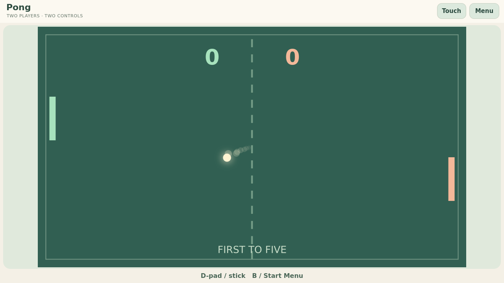

# Pong

**Prepared update (not published):** 0.1.1 improves controller input, field size and effects.
[Repair details and acceptance boundary](../docs/controls-and-presentation.md).

A two-player paddle game. Keep the ball in play, change its angle with the edge
of your paddle, and reach five points. At the three-minute limit, the higher score wins.

Part of the [Competitive Mini-Games](../) collection for TrainerOS.

**Status:** [0.1.0 experimental release](https://github.com/EriArk/crates/releases/tag/pong-v0.1.0)
for Linux x86_64/ARM64, installed through Crates on Odin/Flip. Bot play and Home/Exit
checked remotely on Odin; physical controls and live internet acceptance pending.

Choose **Practice with bot**, **Two on this device**, or **Play with a friend**.
Move up/down with the D-pad or arrows; couch players use WASD and arrows, two
controllers, or their separate touch controls. Back opens the leave confirmation.
Local play pauses for the menu; online play continues. Rematch requires both players online.

For friend play, both open Pong and use TrainerOS **GameHub → Lobby**, select
the game, prepare, both Ready, then organizer Start. Leaving ends the match and
retains the room. Rejoining starts a fresh match. No game state is saved.

[Build, packaging, controls and SDK contract](../arcade-common/README.md).
The organizer calculates the game and sends snapshots through the existing SDK.
Guest input and ball rendering depend on latency; this is not internet-quality
or competitive-ranking certification.

Tournaments, rankings, and ratings are potential future ecosystem features.

Original code and vector/canvas art: [GPL-3.0-or-later](LICENSE).

See [docs/idea.md](docs/idea.md).
