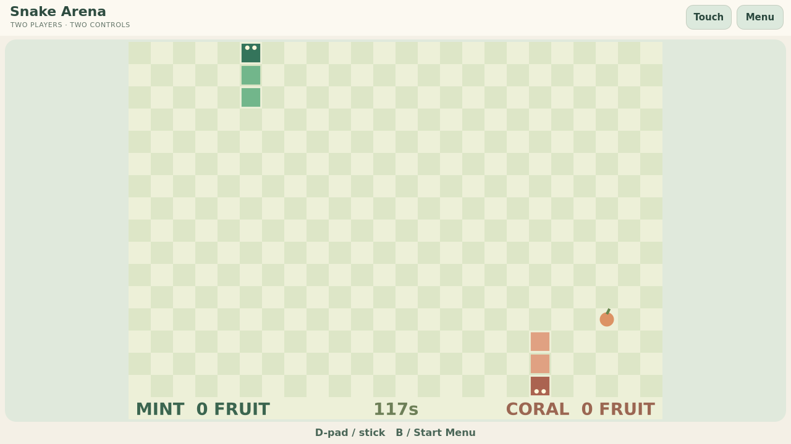

# Snake Arena

**Prepared update (not published):** 0.1.1 improves controller input, field size and effects.
[Repair details and acceptance boundary](../docs/controls-and-presentation.md).

Two snakes share a garden. Eat fruit, grow longer and avoid walls and bodies.
The last survivor wins; simultaneous crashes draw. After two minutes, the longer snake wins.

Part of the [Competitive Mini-Games](../) collection for TrainerOS.

**Status:** [0.1.0 experimental release](https://github.com/EriArk/crates/releases/tag/snake-arena-v0.1.0)
for Linux x86_64/ARM64, installed through Crates on Odin/Flip. Bot play and Home/Exit
checked remotely on Odin; physical controls and live internet acceptance pending.

## Play

Choose **Practice with bot**, **Two on this device**, or **Play with a friend**.
Turn with four directions; direct reversal is disallowed. Couch players use
WASD and arrows, two controllers, or their separate touch controls. Back opens
the leave confirmation. Local play pauses for the menu; online play continues.

For friend play, both open Snake Arena and use TrainerOS **GameHub → Lobby**,
select the game, prepare, both Ready, then organizer Start. A rematch requires
both players. Exit or disconnection ends the round, preserving the room; rejoin
starts fresh. No game state is saved.

## Shared integration

[Build, packaging, controls and SDK contract](../arcade-common/README.md).
The organizer computes simultaneous movement and sends snapshots through the
existing SDK. Guest turns depend on network latency. Live internet play and
physical controls remain unverified; this is not competitive-ranking certification.

The [wider collection plans](../docs/shared-approach.md), including communities,
rankings and tournaments, remain targets. This version supports two players.
Original code and vector/canvas art: [GPL-3.0-or-later](LICENSE).

See [idea notes](docs/idea.md).
