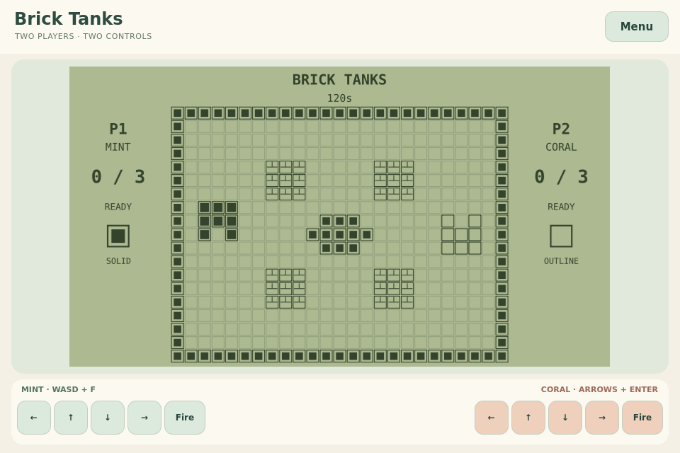

# Brick Tanks

A two-player tank duel on a shared monochrome brick arena.



## Multiplayer design

The symmetric arena provides destructible brick cover, permanent steel and
connected routes around the centre. A central steel block prevents a stationary
shootout from the starting positions: move around it or open a route through bricks.

- Directions move the tank and aim its turret. **Fire** shoots one shell; reload
  limits the rate. Tanks cannot overlap. Opposing shells cancel when they meet.
- Shots remove one brick cell. Steel stops them, including cover immediately
  in front of the muzzle. Break cover to change the available firing lanes.
- Each hit earns a point. The target respawns at a clear edge position with a
  brief shield, so it can re-enter the duel. Firing ends its own shield immediately.
- First to three hits wins; simultaneous third hits draw. After two minutes,
  most hits wins. A rematch restores the arena.

The training bot navigates around steel and seeks a firing lane, using the same
movement, shells and reload. This package implements versus play, not a cooperative
base-defence campaign. Rankings and backend reward submission remain future work.

## Modes and controls

**Two on this device** uses simultaneous independent controls; **Play with a
friend** uses the existing TrainerOS GameHub Lobby/SDK channel. Both players must
agree to an online rematch. Exit ends the round and keeps the Lobby; rejoin starts
a fresh round. **Practice with bot** remains available for learning the controls.

| Player / input | Directions | Fire |
| --- | --- | --- |
| Local Mint / P1 | WASD | F or Space |
| Local Coral / P2 | Arrows | Enter |
| Solo or online | Arrows or WASD | Enter, Space or F |
| Each controller | D-pad | SDL Confirm / A mapping |
| Touch | Labelled arrows | Visible Fire button |

Back/Escape or controller Back/Start opens the exit confirmation. Local play pauses
on focus loss; an online match continues with held directions released. Actions
are discrete taps. P1 uses solid LCD blocks and P2 outlines. These fixed labels do
not claim physical device-specific controller glyph support.

## Build and package

```sh
cmake -S games/competitive-minigames -B build/brick -DCMAKE_BUILD_TYPE=Release -DARCADE_GAMES=tanks
cmake --build build/brick --parallel 3
./build/brick/tanks --windowed
python3 games/competitive-minigames/arcade-common/package.py tanks build/brick/tanks dist/tanks
```

C++20, Qt 6.4+ Quick/Network and SDL2. Original SVG/Canvas art and code are
GPL-3.0-or-later; [LICENSE](LICENSE). No borrowed ROMs, sprites or sounds.
Prepared for Experimental 0.1.0; publication and device acceptance belong to the
main workflow. [Preparation handoff](../docs/brick-duo-preparation.md) records scope
and checks; [shared integration](../arcade-common/README.md) documents SDK limits.
The [initial concept](docs/idea.md) remains as history.
