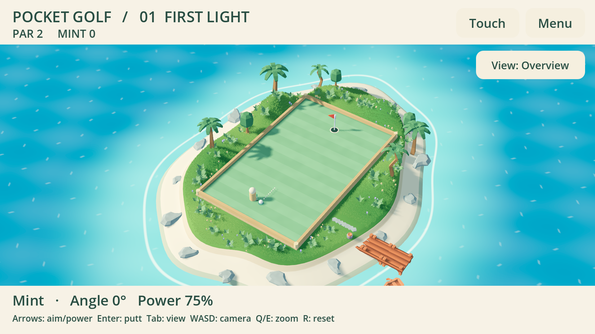

# Pocket Golf

A small, standalone 3D minigolf game for TrainerOS, built with **Godot 4.7.2**.
Three greens: First Light, The Bank Shot, and Sand & Stone. Play a solo round,
pass a controller between two people, or play with a friend through TrainerOS Lobby.

**Preparation build 0.1.5.** Not published or installed on handhelds.
The visible golfer is a temporary abstract marker. The shared TrainerOS avatar
and wardrobe are being developed separately and are **not integrated yet**.



The greens sit on a small sandy island surrounded by animated turquoise water,
with rolling hills, a continuous short-grass meadow, bushes, low-poly palms,
flowers, rocks, a landing and boats. Grass and water reduce subpixel detail in
the distance. Warm sunlight, cool sky fill, filtered shadows, textured turf/sand/wood/stone
and subtle far depth of field give the island depth while keeping the course sharp.
See [lighting, materials and validation](docs/LIGHTING.md) and
[grass, distance rendering and checks](docs/MEADOW.md). Environment models
come from Kenney's free CC0 Nature, Pirate and Minigolf kits; see
[asset sources, licences and visual checks](docs/ISLAND.md).

## Play

- Left/right or stick/D-pad: aim in five-degree steps. Up/down: power in five-percent steps.
- Confirm (bottom face button; A on Xbox), Enter or Space: putt / accept handoff.
- Secondary face button (X on Xbox), Tab, or **View**: overview → shoulder → eyes.
- Right stick or WASD: rotate/look around; right trigger / E zooms in, left trigger /
  Q zooms out. R3 / R restores the selected view. Camera controls never change aim/power.
- Mouse: hold the right button to rotate; wheel to zoom. Touch: drag the green to
  rotate and spread/pinch two fingers to zoom. HUD touches remain ordinary buttons.
- Overview/shoulder zoom changes camera distance; eye zoom changes the field of view.
  Each view retains its own bounded zoom/rotation. A putt smoothly switches to ball
  follow and returns to the selected view for the next stroke. Pause freezes the camera.
- Back / Start / Escape: pause/menu. Confirm **Leave round** ends the round.
- **Touch** reveals direct aiming/power/putt buttons. Hardware input hides them.
- Each player uses their own ball; the other ball does not block a shot. Players
  alternate strokes, skipping anyone already in the cup. Eight strokes ends that
  player's hole. Lowest total across three holes wins; equal totals are a draw.
- The scorecard shows strokes per hole and the total. Rematches alternate the
  starting player. Local handoffs require explicit confirmation.
- A lost controller or window focus opens the pause menu. Local rolling pauses;
  online presentation continues to receive/process the match while local controls
  remain paused. Returning focus does not automatically putt or resume.

## TrainerOS

Both players open **Play with a friend**, then select Pocket Golf in the existing
GameHub Lobby, prepare, mark Ready and let the organizer Start. The game uses
Platform API v1 `lobby.activity` and `network.records`, app ID
`art.abysstail.pocket-golf`, protocol `pocket-golf.1`.

The GDScript client in `addons/traineros/client.gd` uses the existing local JSON-lines
SDK contract. It has no separate login, room service, IP entry, or new relay. Shots
carry angle, power, turn and pre/post-state hashes. Both sides calculate integer
rules; rendering and engine physics never decide the result. Hash agreement detects
divergence, not cheating or eligibility for official rewards.

An unavailable/revoked host returns to the menu and leaves solo/local play available.
Exit or connection loss ends the game session while retaining Lobby membership.
Reconnect requires the normal preparation/Ready/Start flow; unfinished rounds are
not restored. A friend rematch requires both players' votes. The current SDK route
is two players and reliable ordered records; live provider/NAT acceptance is separate.

The avatar seam and remaining integration work are described in
[AVATAR_INTEGRATION.md](docs/AVATAR_INTEGRATION.md). Clothing, appearance selection,
inventory and identity persistence belong to TrainerOS/SDK, never to this game.

## Build and check

Use the official **Godot 4.7.2 standard editor** and its matching export templates.
No .NET, Blender, asset-store downloads or external runtime plugins are required.
The default renderer is Mobile/Vulkan. OpenGL Compatibility can be selected with
`--rendering-method gl_compatibility`; visuals differ and handheld performance still
needs checking. The game has no audio track in this preparation.

```sh
godot --path games/pocket-golf --editor
godot --headless --path games/pocket-golf --script tests/rules_test.gd
godot --headless --path games/pocket-golf --script tests/protocol_test.gd
godot --headless --path games/pocket-golf --script tests/presentation.gd
godot --headless --path games/pocket-golf --script tests/camera_test.gd
godot --path games/pocket-golf --script tests/island_test.gd
python3 games/pocket-golf/build.py --godot /path/to/godot --templates /path/to/templates --output /path/to/build
python3 games/pocket-golf/package.py /path/to/build /path/to/fresh-output
```

`build.py` stages a disposable copy, verifies the pinned engine version, and exports
Linux x86_64, Linux ARM64 and a Windows preview without modifying the source project.
`package.py` creates Crates archives/records, a Windows zip, complete source archive
and checksums. It never publishes. Records remain Experimental / untested; their
release URLs are future destinations. Builds require an editor: official 4.7.2
release templates disable `--script` path overrides, so source tests must use the
editor binary. `tests/HostIntegration.cpp` launches two actual Godot processes against
two real PlatformHosts; see [the preparation record](docs/PREPARATION.md).

Original game/client/procedural environment: GPL-3.0-or-later, see [LICENSE](LICENSE).
Kenney models/textures retain CC0-1.0; their original notices and source hashes
are included in `assets/kenney/` and under `licenses/` in the binary packages.
The unmodified Godot engine is MIT; its notices and bundled third-party licenses
are included under `licenses/`. No model, rig or clothing from the other chat is copied.
