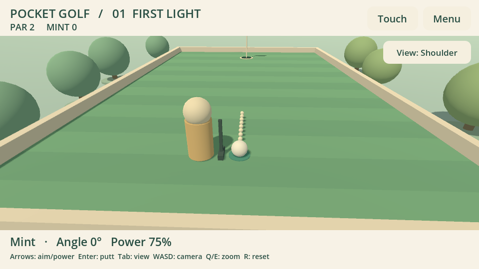
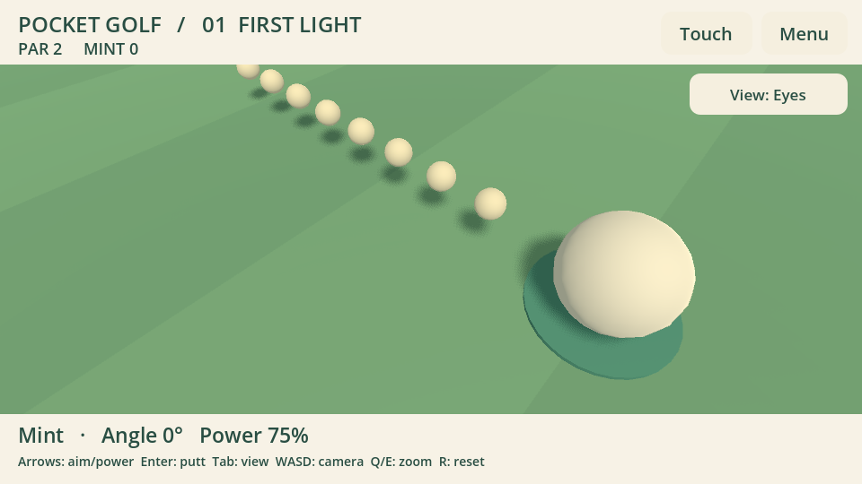

# Камера Pocket Golf 0.1.1

Подготовлено по запросу владельца после оценки первой сборки. Общий вид, за плечом
и из глаз переключаются по кругу; вращение и масштаб сохраняются отдельно для
каждого вида. После удара камера плавно сопровождает мяч, затем возвращается к
выбранному виду. В общем виде сильное приближение смещает центр обзора к мячу.
Пауза замораживает камеру. Меню, ожидание и передача контроллера не принимают
камерный ввод; после потери фокуса требуется нейтральное положение стиков/триггеров.

| Действие | Контроллер | Клавиатура / мышь | Touch |
| --- | --- | --- | --- |
| Сменить вид | X (Xbox), □ (PS), Y (Nintendo) | Tab | View |
| Вращать / осматриваться | Правый стик | WASD / правая кнопка + движение | Перетаскивание поля |
| Приблизить / отдалить | Правый / левый триггер | E / Q или колесо | Развести / свести пальцы |
| Сбросить выбранный вид | R3 | R | Menu → Reset camera |

Приближение из глаз меняет угол обзора, а не перемещает камеру сквозь персонажа.
Наклон, расстояние и угол обзора ограничены; ручная камера не меняет наведение,
мощность, счёт или протокол `pocket-golf.1`. Высота глаз временная; подключение
модели и видимость частей тела уточняются в [контракте интеграции](AVATAR_INTEGRATION.md).

`tests/camera_test.gd` проверяет три вида, границы масштаба, клавиатуру, внедрённые
события кнопок Godot, преобразование значений стика/триггеров, touch через настоящую
сцену, исключение HUD из жестов, положение мяча относительно нижней панели,
сопровождение/возврат, паузу и отсутствие изменений правил. `presentation.gd`
сохраняет полный цикл двух игроков, трёх лунок, счёта, реванша и выхода.
Это не физическая проверка контроллера. Журналы обновления — в `evidence/camera-*`.

Windows Vulkan и Linux OpenGL в тестовом контейнере проверяются отдельно от
портативок. ARM64 — экспорт, без подтверждения запуска и производительности.
Подготовка передаётся основному чату; публикация и SDK-аватар ещё впереди.

Проверки этой подготовки прошли на Windows Vulkan (GTX 1660 Ti) и Linux
OpenGL (Xvfb/Mesa llvmpipe). На Linux также повторно пройден полный UI-цикл.
Результаты предыдущего SDK/TLS-матча сохранены: сетевой протокол и правила не
менялись, новый интернет-матч этими камерными проверками не заявляется.

