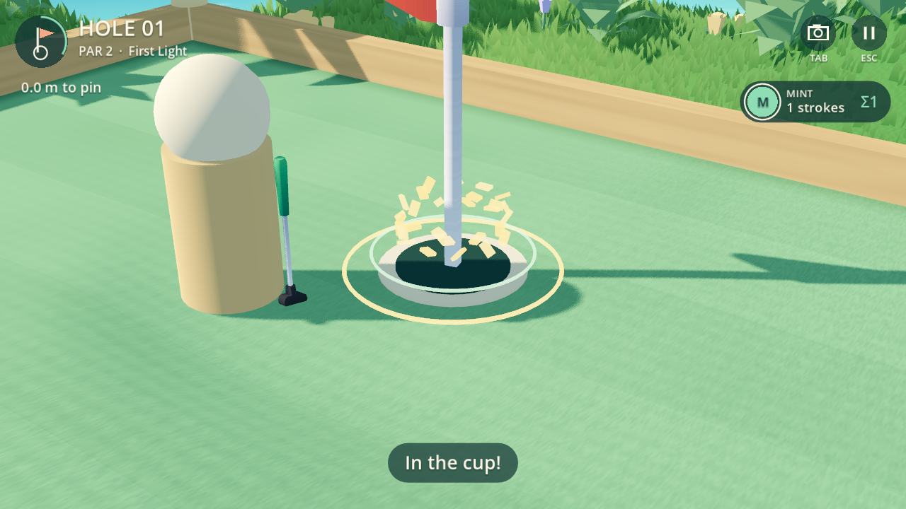
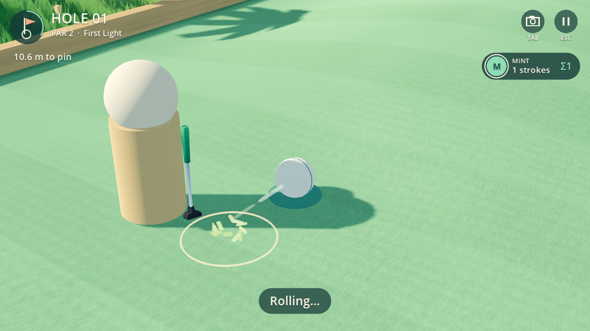
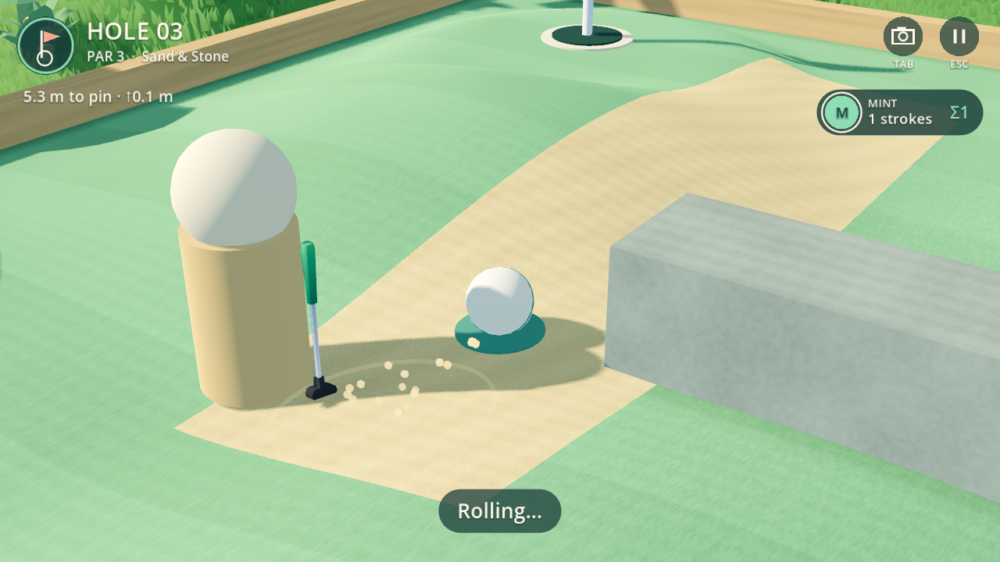
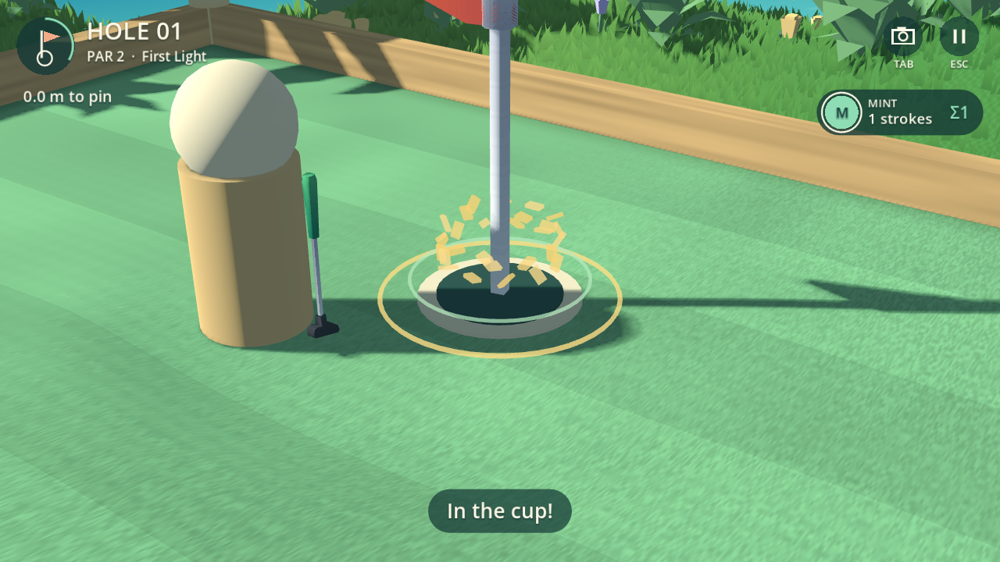

# Pocket Golf 0.1.9 — спецэффекты

Удар сопровождается коротким световым кольцом и травинками либо песчинками;
сильный удар даёт более заметный выброс. При быстром качении за мячом остаётся
мягкий след длиной в несколько кадров. Песок разлетается отдельными зёрнами,
деревянные бортики и каменные стенки дают частицы своего цвета. Касание края
чаши отмечено небольшим бликом. Обычное попадание получает золотое кольцо,
а попадание с первого удара — два кольца и более заметные золотистые частицы.

## Привязка к игре

`scripts/golf_effects.gd` отвечает только за представление. Он читает готовую
траекторию, высоты, индексы отскоков, касаний чаши и количество ударов. Правила,
физика, сетевые команды и дайджест состояния не изменены: сохранены
`pocket-golf.3` / `slopes-3`, совместимые с 0.1.8.

Время и координаты эффектов берутся из соответствующего отсчёта, даже если
рендер пропустил несколько кадров. Для отскока точка на поверхности мяча
оценивается по изменению направления скорости. Уже истёкшие частицы не появляются
заново после долгой задержки. Праздник начинается над поверхностью чаши, а не
на конечной позиции утонувшего мяча. Частицы оседают на рельеф.

Локальная пауза останавливает их время вместе с мячом. При сетевой паузе показ
продолжается, как и прежде продолжалось движение мяча. Новый удар, перестройка
поля и выход очищают ожидающие события. Камера не трясётся, включая вид от глаз.

Пул переиспользует не более 128 MeshInstance3D, геометрия общая, тени частиц
отключены. След существует 0,16 с, частицы — до 0,78 с. Это ограничение нагрузки,
а не доказательство производительности на портативках. Новых ассетов, лицензий
или зависимостей нет. Звук, SDK-персонаж и гардероб в этот проход не входят.

## Проверки

`tests/effects_presentation.gd` проходит на Windows / GTX 1660 Ti / Vulkan Mobile
и Linux / Xvfb / Mesa llvmpipe / OpenGL Compatibility:

- реальные удары, дерево/камень/песок, край чаши, обычное попадание и hole-in-one;
- соответствие контакта бортику, отсутствие повторного события на том же кадре;
- одинаковые позиции и количество живых частиц при 30/60/144 Гц;
- локальная пауза, продолжение сетевого показа при паузе, неизменный дайджест;
- пропуск истёкших событий, насыщение/освобождение пула, выход и перестройка поля.

В выбранных кадрах сценариев было до 30 живых частиц; отдельный стресс проверяет
лимит 128. Это не глобальный замер пиков всей игры. Кадры обоих рендереров
просмотрены. Регрессии `physics_presentation` и `presentation` проверяют
интерполяцию, качение, паузу, падение, полный локальный матч, реванш и выход.
Ввод синтетический; результаты устройств и живой сетевой пары здесь не заявлены.
Журнал: [effects-checks.txt](effects-checks.txt).

Предыдущие проверки физических траекторий 0.1.8 сохранены: соответствующие
исходники не менялись. Портативки, физический контроллер/сенсор, производительность,
живая сеть и художественная оценка владельца остаются основному чату.
