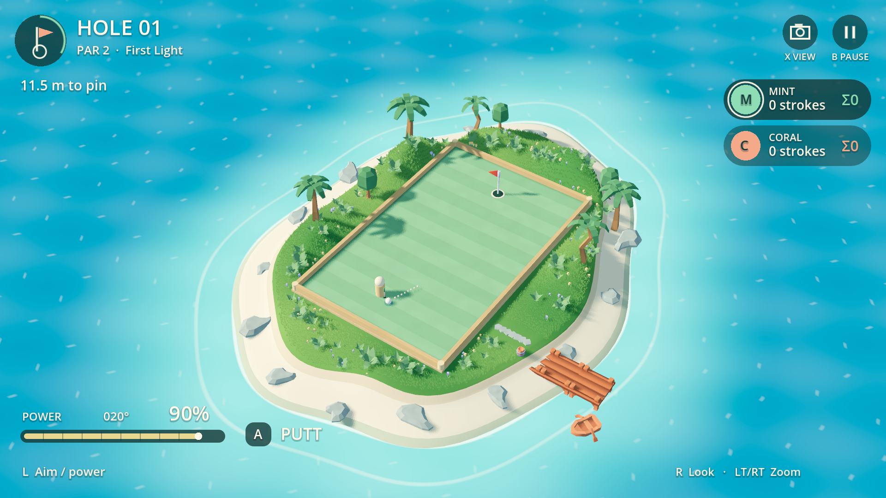
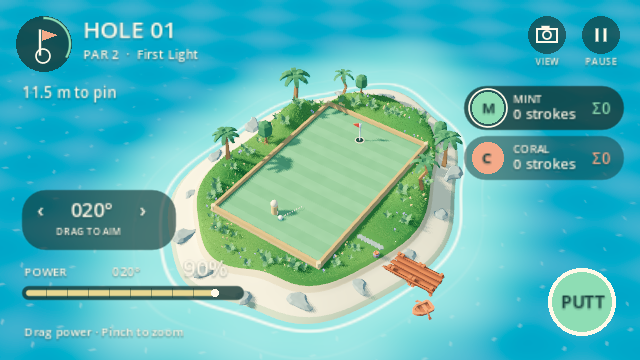
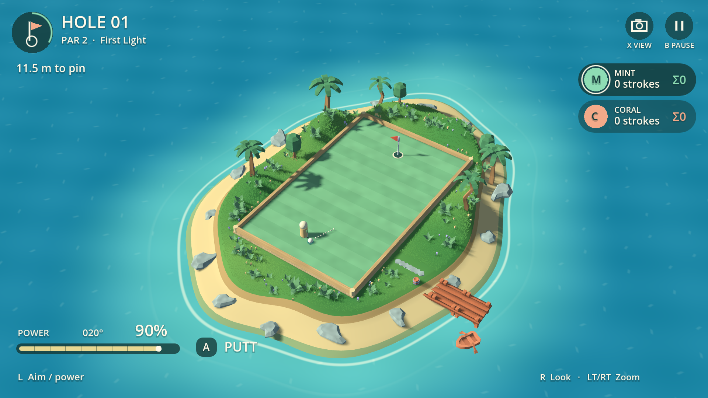

# Pocket Golf 0.1.6 — игровой интерфейс

Широкие верхняя и нижняя панели убраны. Сцена видна до краёв игрового кадра;
информация расположена небольшими отдельными элементами поверх неё.

## Что видно во время игры

- Слева сверху — номер лунки, par, название и расстояние до флажка.
- Справа — игроки, число ударов на текущей лунке и сумма за раунд (`Σ`), включая
  текущую лунку. Кольцо выделяет активного игрока; в online есть отметка YOU.
  Буквы в кружках временные: отдельного аватара или гардероба игра не создаёт.
- Снизу слева — тонкая шкала силы, её процент и угол. Рядом короткая подсказка
  удара. При движении мяча и во время чужого хода эти действия скрываются;
  вместо них появляется короткий статус.
- Две небольшие иконки дают доступ к камере и паузе. Подсказки клавиатуры и
  геймпада меняются по последнему активному вводу; сохранены обозначения
  Xbox, PlayStation и Nintendo из существующего определения контроллера.
- Полная справка по управлению перенесена в паузу. Меню, передача хода,
  ожидание Lobby и итоговый счёт используют отдельное центральное окно.

## Сенсор и мышь

Отдельной кнопки Touch больше нет. Первое касание показывает компактную область
«DRAG TO AIM» и одну круглую кнопку PUTT. Горизонтальное движение прицела меняет
угол прежними шагами 5°, шкала силы сохраняет шаг 5% и границы 10–100%.
Жесты на поле по-прежнему вращают камеру и меняют zoom двумя пальцами.

Каждое касание закрепляется за своим элементом до отпускания: прицел/шкала не
поворачивают камеру, второй палец на поле может работать независимо. Уход пальца
с PUTT отменяет удар; повторное мышиное событие, сгенерированное сенсором, не
переключает камеру второй раз. Смена способа ввода, пауза, удар и потеря фокуса
очищают захваченные касания. При клавиатуре/геймпаде сенсорный прицел скрывается.
Мышью доступны шкала силы, удар и обе иконки; правое перетаскивание и колесо
сохраняют управление камерой.

HUD увеличивает относительный размер элементов в окнах уже 960 пикселей, до 1.5×
при 640 пикселях. Так основные цели касания не уменьшаются вместе со всем окном.
Подсказки, оформление и обработка указателей вынесены в `scripts/golf_hud.gd`;
действия по-прежнему проходят через основной контроллер и Match.

## Просмотренные примеры

- [Mario Golf: Super Rush, официальный сайт Nintendo](https://www.nintendo.com/en-gb/Games/Nintendo-Switch-games/Mario-Golf-Super-Rush-1923515.html):
  отдельная шкала удара и информация о лунке/игроке. Просмотрен
  [официальный кадр](https://www.nintendo.com/eu/media/images/08_content_images/games_6/nintendo_switch_7/nswitch_mariogolfsuperrush/CI_NSwitch_MarioGolfSR_Screen_CallTheShots_01_UK.jpg).
- [Golf With Your Friends, страница издателя в Steam](https://store.steampowered.com/app/431240/Golf_With_Your_Friends/):
  компактная информация по краям, свободный центр кадра, самостоятельный
  индикатор силы. Просмотрен [кадр из галереи](https://cdn.cloudflare.steamstatic.com/steam/apps/431240/ss_81d17def30193cab366b5c5f0f03baf4dea890d6.1920x1080.jpg).

Это ориентиры композиции. Все элементы нового HUD нарисованы кодом игры;
чужие изображения, иконки и шрифты в пакет не перенесены.

## Проверки и ограничения

`hud_test.gd` отправляет настоящие события ввода в дерево Godot: сенсорные
прицел/сила/удар, два пальца, отмена удара, переключение способа ввода, защита от
дублированного мышиного события, чужой ход, сумма ударов, пауза и маленькое окно.
`camera_test.gd` проверяет сохранённые виды/zoom, мышь/жесты и изоляцию правил;
`presentation.gd` проводит локальную пару через все три лунки, результат, реванш
и выход. [Журнал](hud-checks.txt).

Проверены Windows / GTX 1660 Ti / Vulkan Mobile и Linux / Xvfb / Mesa llvmpipe /
OpenGL Compatibility. Итоговые снимки обоих вариантов просмотрены. Ввод
синтетический: физический контроллер, сенсор портативки и живая сетевая пара
остаются приёмкой основного чата. Сценарий чужого хода в тесте — локальная фикстура,
а не доказательство сетевой игры.

Свет и оформление из 0.1.5 сохранены; сетевой протокол и детерминированные правила
не менялись. Точные сборки и результаты проверки установки указаны в
[передаче основному чату](../../../docs/POCKET_GOLF_HANDOFF.md).
