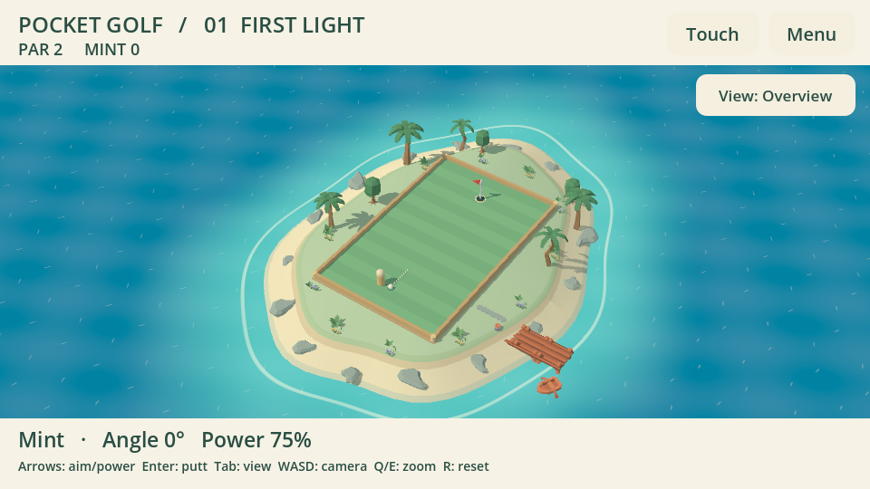
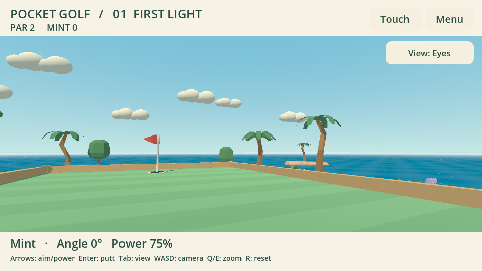

# Pocket Golf 0.1.2 — остров и бесплатные ассеты

Поле встроено в небольшой остров: травяная верхняя часть, песчаный берег,
мелководье и море. Вода использует собственный лёгкий шейдер с волнами, бликами
и прибоем по форме берега, без чтения depth/screen texture. Пальмы слегка качаются,
лодка покачивается у причала; вдали находятся скалы, парусник и облака.
Деревья, кусты и цветы располагаются за границами игрового прямоугольника.
Декорации не участвуют в столкновениях, расчёте удара и сетевой синхронизации.

## Источники

Поиск и загрузка выполнены 23 октября 2026 с официального сайта автора.

| Набор | Используется | Лицензия |
| --- | --- | --- |
| [Kenney Nature Kit](https://kenney.nl/assets/nature-kit), архив 2.1 | 13 моделей: пальмы, два небольших дерева, кусты, трава, цветы и камни | CC0-1.0 |
| [Kenney Pirate Kit](https://kenney.nl/assets/pirate-kit), 2.1 | 4 модели: причал, бочка, лодка и парусник; цветовая карта | CC0-1.0 |
| [Kenney Minigolf Kit](https://kenney.nl/assets/minigolf-kit), 3.1 | Флаг и клюшка; цветовая карта | CC0-1.0 |

В проект включена только используемая подборка: 19 GLB и две карты цветов.
Исходные файлы автора сохранены побайтово. В сцене созданы отдельные матовые
материалы: отключён импортированный metallic и согласованы зелёные, древесные
и каменные оттенки. Глобальные оригинальные материалы/исходники не переписываются.
Масштаб и расположение моделей задаются игрой.

Ссылки на точные архивы, SHA-256 архивов и каждого включённого файла:
[`assets/kenney/provenance.json`](../assets/kenney/provenance.json).
Исходные LICENSE.txt сохранены в каждой подпапке набора; пакетный скрипт также
добавляет их и provenance в `licenses/` Windows/Linux архивов.
GPL игры не заменяет лицензии этих ассетов. Модель пользователя/гардероб не менялись.

## Проверка и продолжение

`island_test.gd` проверяет загрузку настоящих GLB, направление нормалей поверхности,
отсутствие коллизий декораций, свободное от крон поле, сохранение игрового состояния
при анимации окружения и освобождение старого острова при переходе между лунками.
Снимки снимаются с настоящего рендера, включая вид на горизонт, обратную сторону,
третью лунку и приближение. Проверки камеры и полного раунда остаются отдельными.
Манифест сборки теперь включает шейдер и ассеты: устаревший экспорт после их правки
не принимается упаковщиком.

Windows/Vulkan и Linux/OpenGL (Xvfb, Mesa llvmpipe) прошли проверку острова,
камеры и полного игрового цикла; сцены просмотрены. В Compatibility снижены
энергии солнца/окружения, чтобы компенсировать пересветку относительно Mobile.
Это отдельная визуальная настройка, не обещание одинаковых пикселей на всех GPU.
Журналы находятся в `evidence/island-*`.

Приёмка цвета/масштаба владельцем и производительность на Odin/Flip остаются
следующими шагами основного чата. ARM64 экспорт не равен запуску. Сеть и правила
`pocket-golf.1` не менялись; новый интернет-матч в этой подготовке не заявляется.

