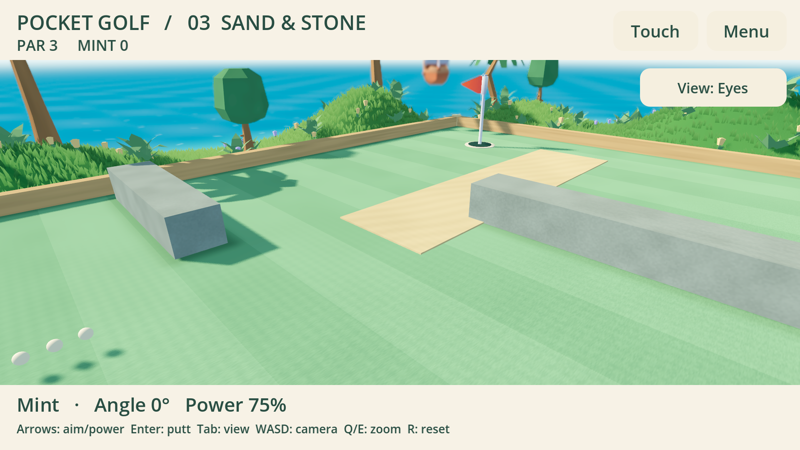
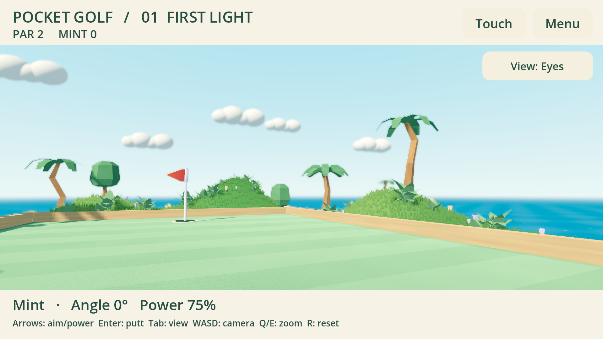
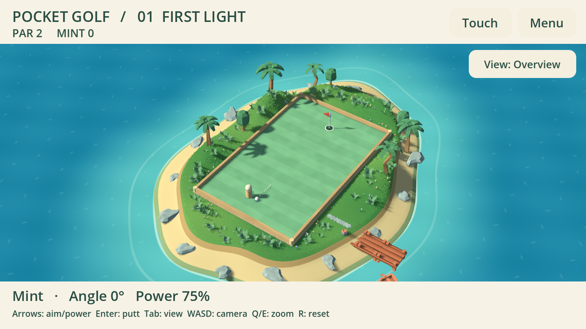

# Pocket Golf 0.1.5 — свет, фактура и глубина

Тёплое боковое солнце и прохладное заполнение отделяют освещённые поверхности от
теней. Пальмы отбрасывают тени поперёк поля; у камней, бортиков и временного
персонажа лучше читается объём. Нормали холмов меньше сглаживаются вверх, поэтому
сам рельеф участвует в освещении. Low-poly геометрия сохранена.

## Свет и материалы

- Один DirectionalLight3D, четыре каскада, карта теней 4096, PCF и смешивание
  каскадов. Дальность 125 м покрывает максимальное отдаление обзорной камеры.
  Bias настроен после просмотра кадров: слишком маленький давал зернистое
  самозатенение на газоне и деревьях. Мелкая трава по-прежнему не отбрасывает тени.
- Vulkan Mobile использует ACES. OpenGL Compatibility отдельно настроен с
  линейным отображением тонов и другой энергией света: общий ACES-профиль давал
  чрезмерно яркие зелёные и жёлтые поверхности. Это два проверенных оформления,
  а не обещание попиксельного совпадения рендереров.
- Собственный процедурный материал задаёт короткие волокна газона, зерно и
  небольшую рябь песка, продольную фактуру дерева, пятна и шероховатость камня.
  Мелкая вариация нормалей и шероховатости остаётся низкоконтрастной. Размер
  детали задаётся в координатах поверхности; экранные производные гасят детали,
  которые становятся меньше пикселя. Исходные модели и палитры Kenney сохранены.
- Газон получает мягкое аналитическое затемнение у бортиков и прямоугольных
  препятствий; корни мелкой травы слегка затемнены. Это локальная художественная
  имитация контакта, не SSAO и не запечённое глобальное освещение.

## Камера

В Vulkan Mobile добавлен дальний DOF с максимальной силой 0.055 и переходом 22 м.
Начало размытия вычисляется после интерполяции камеры: берётся глубина мяча и
всего игрового прямоугольника с запасом. Мяч, лунка и препятствия сохраняют
резкость при повороте, zoom, переключении вида и сопровождении удара.
Ближнего размытия нет. В OpenGL Compatibility DOF недоступен в движке и отключён;
сохраняются тени, материалы и дальняя дымка. Интерфейс рисуется отдельно.

[Поворот камеры](lighting-eyes-sweep.mp4) записан из 96 кадров и собран в 24 кадра/с.
Просмотрены контрольные кадры последовательности; это визуальная запись, не
измерение FPS портативного устройства.

## Проверки и передача

Проверки выполняются редактором Godot 4.7.2; release-шаблон не исполняет `--script`.
`tests/lighting_test.gd` сравнивает реальный кадр с включёнными/выключенными тенями
и DOF, проверяет резкость игрового поля при переходах камеры и неизменность
состояния матча. `distance_view.gd` проверяет 540p/1080p, видимость травы, zoom и
запись поворота. Сохранены проверки острова, камеры и полного локального цикла
двух игроков с реваншем/выходом. Результаты: [журнал](lighting-checks.txt).

Windows проверен на GTX 1660 Ti / Vulkan Mobile. Linux — в изолированном Xvfb /
Mesa llvmpipe / OpenGL Compatibility. Физический контроллер и портативки в этом
проходе не проверялись; результаты синтетического ввода не заменяют их приёмку.
Стоимость новой карты теней и DOF на Odin/Flip ещё нужно измерить.

Публикация, установка на портативки и живая сетевая проверка остаются основному
чату. Аватар и гардероб по-прежнему принадлежат будущему модулю SDK; здесь остаётся
временный персонаж. Сборки, точные хеши и проверка установки описываются в
[актуальной передаче](../../../docs/POCKET_GOLF_HANDOFF.md).

## Основания выбора

- [Godot: свет, каскады и смещения теней](https://docs.godotengine.org/en/stable/tutorials/3d/lights_and_shadows.html).
- [Godot: CameraAttributesPractical и ограничения DOF](https://docs.godotengine.org/en/stable/classes/class_cameraattributespractical.html).
- [Godot: возможности рендереров](https://docs.godotengine.org/en/stable/tutorials/rendering/renderers.html).
- [Godot: окружение и отображение тонов](https://docs.godotengine.org/en/stable/tutorials/3d/environment_and_post_processing.html).
- [Godot: свойства материалов и нормалей](https://docs.godotengine.org/en/stable/tutorials/3d/standard_material_3d.html).

Запечённый LightmapGI изучен, но не включён: сейчас остров и посадки строятся
программно, а для качественной запечки понадобятся сохранённые сцены/UV2 и
отдельный воспроизводимый процесс подготовки. Для этой версии используются
динамический свет, заполнение и локальное затемнение материалов.
