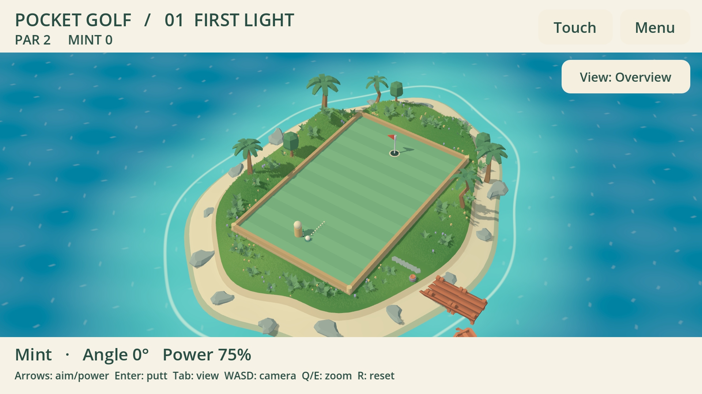
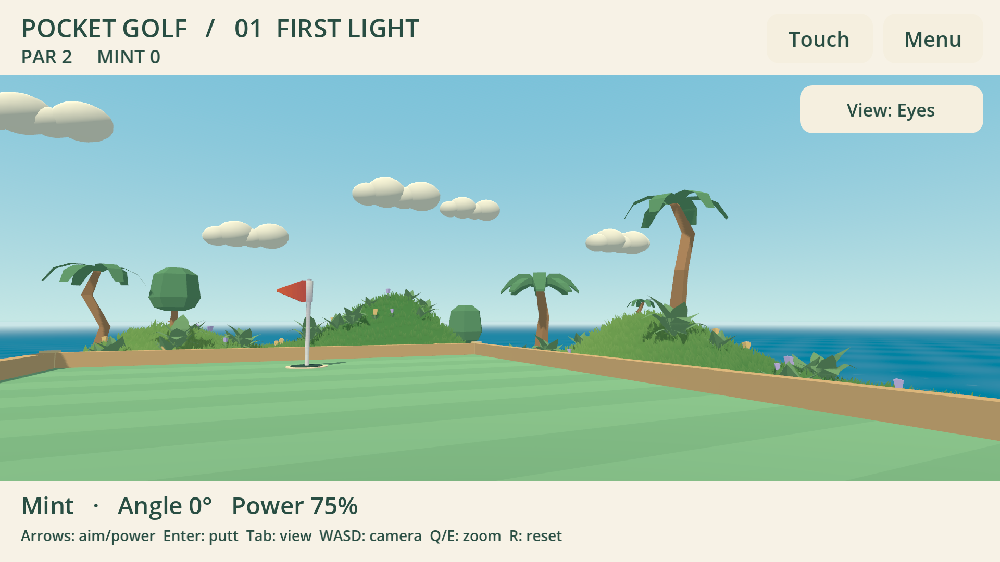

# Pocket Golf 0.1.4 — сплошная трава и читаемая даль

Зелёная часть острова покрыта мелкой травой, включая вершины холмов. На трёх
лунках 4610–4623 небольших пучка по пять травинок, разбитых на 23–24 пространственных
MultiMesh для отсечения невидимых участков. Сохраняются кусты, цветы, чистый игровой
газон и проход к причалу. Посадки используют высоту фактических треугольников земли.

Мелкая трава — собственная непрозрачная геометрия из трёх треугольников на травинку.
Общий шейдер согласовывает цвет травы и земли, добавляет широкие мягкие цветовые
пятна и светлые кончики. Обе стороны травинки освещаются одинаково; корни неподвижны,
верхушки колышутся общими волнами ветра. Карточки с альфа-прозрачностью не используются.

При малом размере на экране геометрия травинки плавно уменьшается до основания.
Этот переход учитывает проекцию камеры, масштаб пучка и высоту окна, поэтому
работает и в общем виде с узким объективом, и из глаз. Это уменьшение видимого
деталирования в шейдере, а не сокращение числа отправленных вершин внутри участка.
Сам участок отсекается движком целиком. Тени от мелкой травы отключены.

В море производные экранных координат ослабляют слишком мелкие блики, линии пены
и волны у горизонта. Добавлена лёгкая дальняя дымка от 80 до 240 м. MSAA увеличено
с 2× до 4× после сравнения снимков. Из глаз вертикальный FOV по умолчанию 60°,
пределы 38–75°; прежняя граница 85° заменена. Zoom и ручное вращение сохранены.
Начальное окно desktop preview теперь 1280×720. База интерфейса остаётся 960×540;
`canvas_items` позволяет 3D рисоваться в реальном размере окна, включая 1080p.

## Проверки и ограничения

- Windows / GTX 1660 Ti / Vulkan Mobile: геометрия посадок, камера и полный цикл
  двух игроков прошли. Linux / Xvfb / Mesa llvmpipe / OpenGL Compatibility:
  те же проверки прошли. Физический контроллер не подключался.
- Реальный рендер в 540p и 1080p: трава видна в сравнении со скрытыми пучками,
  MSAA 2× и 4× дают корректный кадр. Сцены обоих рендеров просмотрены.
- Дополнительно на Windows проверены широкий глазной объектив и максимальное
  отдаление общего вида. Записаны 96 кадров плавного поворота, просмотрены
  контрольные кадры. [Ролик](meadow-eyes-sweep.mp4) собран с частотой 24 кадра/с;
  это визуальная запись, не измерение производительности.
- `island_test.gd` проверяет покрытие зелёного пояса, положение травы/кустов,
  отсутствие декораций внутри игрового поля и освобождение предыдущего острова.
  `distance_view.gd` дополнительно проверяет фактическую видимость травы, разрешения,
  сглаживание и неизменность игрового состояния. Журналы — `evidence/meadow-*`.
- Протокол и правила `pocket-golf.1` не менялись. Shared avatar/гардероб остаются
  отдельной интеграцией TrainerOS/SDK. Запуск ARM64, живой интернет-матч, физический
  ввод и производительность Odin/Flip не заявлены. Публикация и устройства — в основном чате.

## Исследованные приёмы

[Jess Hider](https://jesshiderue4.wordpress.com/materials/stylized-wind-blown-grass/)
описывает согласование основания травы с землёй и неподвижные корни при ветре.
[Bramwell](https://github.com/bramreth/Godot-4-3D-Stylized-Grass) показывает
стилизованную траву в Godot. Документация Godot:
[MultiMesh](https://docs.godotengine.org/en/stable/tutorials/performance/using_multimesh.html),
[сглаживание](https://docs.godotengine.org/en/stable/tutorials/3d/3d_antialiasing.html),
[окружение](https://docs.godotengine.org/en/stable/tutorials/3d/environment_and_post_processing.html).
Здесь реализованы собственные меш и шейдер; сторонний код не копировался.
Прежние ассеты Kenney и их CC0-лицензии сохранены: [источники](ISLAND.md).

