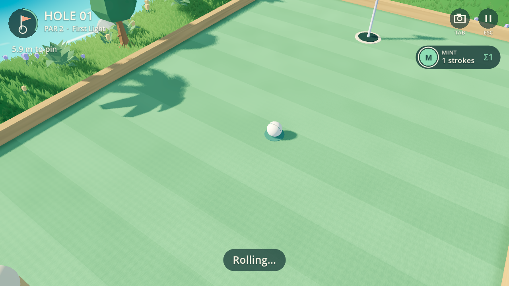

# Pocket Golf 0.1.7 — удар, качение и лунка

Историческая запись 0.1.7. В 0.1.8 плоское поле заменено игровым рельефом,
добавлена составляющая гравитации по склону и протокол `pocket-golf.3`;
см. [текущий рельеф и проверки](SLOPES.md). Проверки и суммы ниже относятся к 0.1.7.

Мяч движется медленнее, плавно теряет скорость и вращается при качении.
У стенки сохраняется касательная составляющая скорости; у углов препятствий
используется нормаль контакта круглого мяча. Песок тормозит сильнее газона.
Медленный центральный удар проваливается в лунку, быстрый проходит над ней,
касание края может отклонить траекторию без автоматического попадания.

## Расчёт

`scripts/ball_physics.gd` — общая авторитетная модель. Целочисленные координаты
с точностью 0,1 мкм, 120 шагов в секунду; наружу выдаются точки в миллиметрах.
Результат удара не зависит от кадровой частоты и физического движка рендера.
`rules.gd` сохраняет очередность, счёт, лимит восьми ударов и три лунки.

| Параметр | Значение |
| --- | --- |
| Начальная скорость | 0,84–8,4 м/с при силе 10–100% |
| Замедление на газоне | 1,368 м/с² |
| Замедление в песке | 6,912 м/с² |
| Радиус мяча / чаши | 0,18 / 0,33 м, стилизованный масштаб |
| Отскок | 72% нормальной скорости; касательная сохраняется |
| Захват чашей | центр ближе 0,15 м, скорость не выше 2,16 м/с |
| Видимое падение | 0,3 с, без изменения размера мяча |

Торможение использует евклидову длину скорости; округление компонент симметричное.
В тесте 72 направлений с силой 30% дальность 2330,139–2331,853 мм: разброс
1,714 мм (около 0,074%). Прежняя зависимость торможения от максимальной компоненты
скорости устранена. Начальное направление по-прежнему задаётся с шагом 5°,
сила — 5%; это граница текущего управления, а не точность внутреннего расчёта.

Столкновения проверяются через ближайшую точку прямоугольника к центру мяча.
При старте с полной силой мяч проходит 70 мм за шаг; тест стенки толщиной 1 мм
проверяет отсутствие сквозного прохода. Это дискретная аркадная модель контакта,
не непрерывный решатель столкновений произвольной трёхмерной геометрии.
Лунка моделируется неглубокой областью притяжения и захватом центра на малой
скорости: отскоки вверх и полноценное движение по внутренней стенке чаши не заявляются.

## Отображение и сеть

Между точками траектории выполняется интерполяция; вращение суммирует пройденные
отрезки даже при пропуске кадров. Камера следует за чашей на уровне газона,
когда мяч опускается ниже поверхности. Локальная пауза останавливает показ;
в online сохранено продолжение партии при открытом меню.

Протокол изменён с `pocket-golf.1` на `pocket-golf.2`; `rolling-2` входит в
хэш состояния. Обновиться должны оба участника. Транспорт, Lobby и SDK не
переписывались. Передаются прежние команды удара и хэши состояния, а каждый
участник рассчитывает результат локально. Это проверка согласованности, не античит.

## Проверки и границы

- Windows x86_64 / Godot 4.7.2: физика, правила, протокол; реальный Vulkan Mobile
  на GTX 1660 Ti — интерполяция, вращение, пауза, падение и полный локальный матч.
- Linux x86_64 / Godot 4.7.2 в изолированном контейнере: тот же расчёт; настоящий
  OpenGL Compatibility через Xvfb / Mesa llvmpipe — показ движения и полный матч.
- 365 траекторий дали одинаковый хэш на Windows и Linux:
  `de440738af43a36729bf263051ab96061fd03b8896aa919d502ab23d7eb17c61`.
  Проверены границы, остановка, круглый угол, касательное движение, тонкая стенка,
  песок, прямой/быстрый/касательный удар у чаши и близкий промах.
- Решатель завершил все шесть лунок для двух игроков: `[[1,2,2],[1,2,2]]`.
  Полный интерфейсный цикл проверяет результат, реванш и выход.
- Ввод в автоматических проверках синтетический. Портативки, физический
  контроллер/сенсор, субъективное ощущение удара и живая сетевая пара остаются
  проверке владельцем в основном чате. ARM64 не исполнялся.

Журнал: [physics-checks.txt](physics-checks.txt). Сборки и точные суммы:
[передача основному чату](../../../docs/POCKET_GOLF_HANDOFF.md).

Игровое поле остаётся плоским; окружающие холмы декоративные. Следующий шаг после
оценки этой физики — согласованные уклоны геометрии и расчёта. Прыжки, управляемое
вращение и столкновения мячей не добавлены. Общий аватар/гардероб остаётся в SDK.
