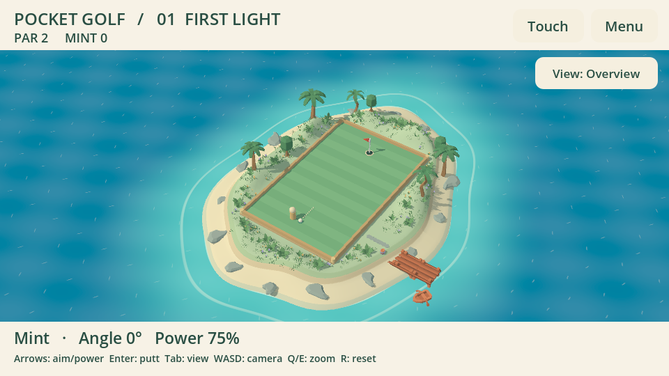
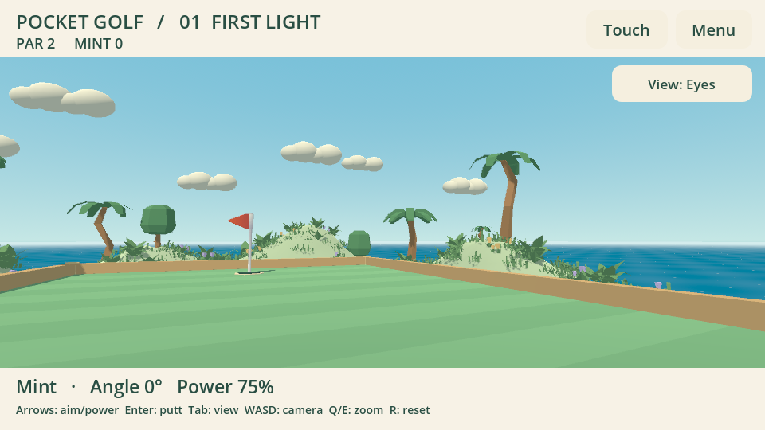
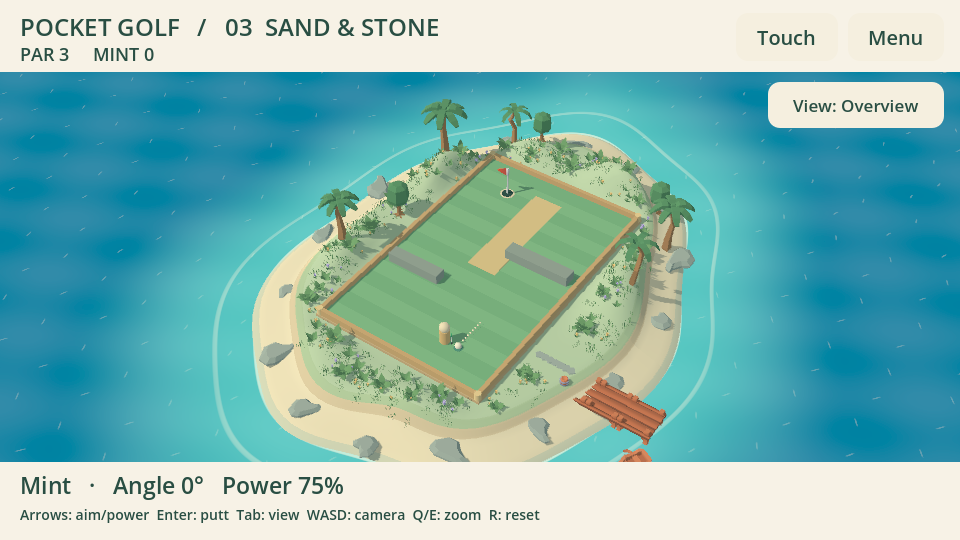

# Pocket Golf 0.1.3 — трава, кусты и рельеф

Вокруг поля появились холмы и плавные склоны, высота поверхности достигает 1,82 м
относительно поля. На переднем плане бугры ниже, позади лунки выше. Это геометрия
самого острова; растения стоят на его поверхности. Игровой газон остаётся ровным.

25 групп посадок содержат 75 кустов, 100 цветов и 403–416 пучков травы в зависимости
от лунки. Размеры и повороты меняются внутри групп, между ними остаются просветы.
Проход к причалу сохранён; ступеньки также учитывают рельеф. Используются прежние
CC0-модели Kenney; [источники и лицензии](ISLAND.md) остаются действительными.

Трава использует один MultiMesh вместо сотен узлов. Растения привязаны к высоте
реальных треугольников поверхности, чтобы не висеть над склонами между вершинами.
Кусты и кроны отведены от игрового прямоугольника. Окружение не добавляет коллизий,
не меняет правила `pocket-golf.1`, сетевую синхронизацию или управление камерой.
Гардероб и будущий аватар по-прежнему принадлежат TrainerOS/SDK.

## Проверки 23 октября 2026

- Windows: сцена с настоящим Vulkan Mobile рендером; общий, обратный, близкий виды,
  горизонт и третья лунка просмотрены. Камера и полный игровой цикл прошли headless
  проверки с внедрёнными событиями Godot Joypad.
- Linux x86_64: OpenGL Compatibility, Xvfb/Mesa llvmpipe; снимки просмотрены,
  проверки острова, камеры и полного цикла прошли.
- На всех трёх лунках проверены возвышения в самом меше, отсутствие земли/растений
  внутри игрового газона, посадка на склонах, свободный проход для травы, число
  групп отрисовки и освобождение предыдущей сцены.
- Журналы: `evidence/relief-*`. Снимки ниже — Windows, не художественные макеты.

Экспорт ARM64, физический контроллер, производительность на Odin/Flip и реальный
интернет-матч — разные проверки. Запуск на портативках и публикация остаются
основному чату; они не заявлены этими проверками исходников. Следующий шаг здесь —
оценка оформления владельцем, затем интеграция готового аватара SDK.

