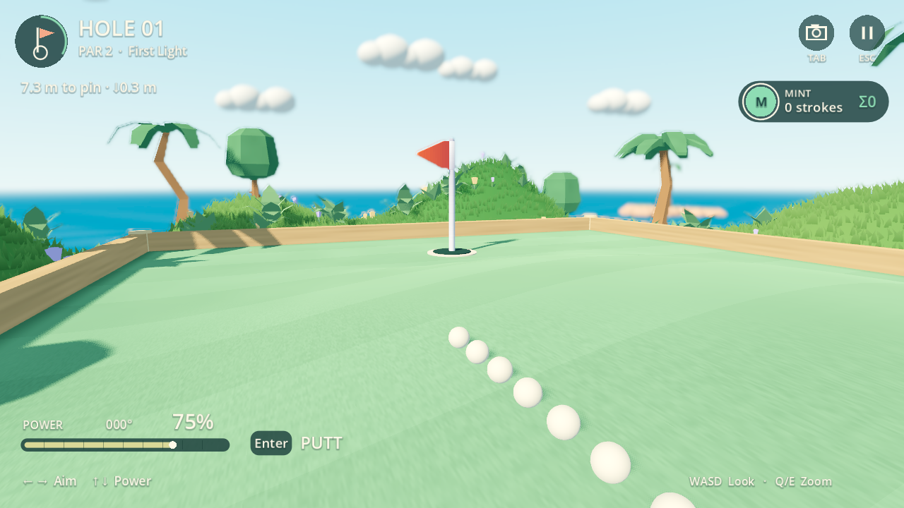
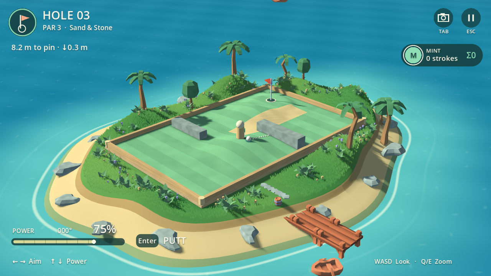

# Pocket Golf 0.1.8 — игровые уклоны

Рельеф появился на самом игровом поле. На подъёме мяч быстрее теряет скорость,
на спуске катится дальше и может ускоряться, поперечный склон отклоняет удар.
Слабый удар на крутом подъёме способен скатиться обратно. Вокруг старта и чаши
сохранены ровные площадки; бортики по периметру стоят на прежней высоте.

## Три поля

| Поле | Рельеф | Максимальная высота / высота чаши |
| --- | --- | --- |
| First Light | широкий центральный холм | 0,650 / 0,016 м |
| The Bank Shot | боковой склон вокруг препятствия | 0,800 / 0,066 м |
| Sand & Stone | два подъёма по сторонам песчаного участка | 0,598 / 0,276 м |

Песок окрашен на той же поверхности, поэтому повторяет все её уклоны.
Каменные препятствия продолжаются ниже газона и не висят над его низкой стороной.
Мяч, метка игрока, прицельные точки и ноги временного персонажа учитывают высоту
поля; вид от глаз использует высоту земли под персонажем. Камера при попадании
следит за чашей на её высоте. Минимальная высота плечевой камеры учитывает верх
поднятых препятствий. В HUD около расстояния показано, насколько флажок
выше или ниже текущего положения мяча.

## Общая поверхность для изображения и движения

`green_surface.gd` строит целочисленную сетку 41 × 65 вершин с шагом 250 мм.
Её 5120 треугольников одновременно задают видимую поверхность, высоты и градиенты
для физики. Между вершинами используются те же плоскости треугольников; отдельной
приближённой поверхности столкновений нет. Сглаженные нормали улучшают освещение,
но не меняют вершины. Высота центра мяча учитывает зазор сферы над наклонной плоскостью.

Расчёт остаётся целочисленным, 120 шагов/с. Добавлена касательная составляющая
гравитации с эффективным ускорением около 7 м/с², соответствующая приближению
качения сплошного шара. Трение травы/песка и отскоки сохранены. На достаточно
пологом склоне мяч может остановиться; на крутом свободном склоне нулевая скорость
на вершине подъёма не замораживает дальнейшее скатывание. Контакт с препятствием
может удерживать мяч. Максимальная длина расчёта — 15 с; проверки требуют реальной
остановки, а не достижения этого ограничения.

Целочисленный квадратный корень ускорен начальным приближением по разрядности.
Проверены границы квадратов, в том числе около 10¹⁸; полный хэш траекторий до и
после оптимизации совпал. Перебор в тестовом решателе повторно использует решение
для одинаковой позиции двух игроков; реальные удары выполняются для обоих.

Сетевой протокол — `pocket-golf.3`, ревизия состояния — `slopes-3`. Обоим игрокам
нужна совместимая версия; предыдущие правила отклоняются. Lobby, транспорт и
порядок хода сохранены. Хэши проверяют согласованность, не защищённость от читов.

## Проверки

- Сравнение с независимым лучом Godot по всем 15360 треугольникам трёх полей:
  максимальная ошибка высоты 0,997 мм, в пределах миллиметрового округления.
- На проверочном плоском/10% склоне при силе 25%: 1620 мм по ровному,
  1072 мм вверх и 3291 мм вниз. Поперечный удар ушёл на 557 мм вниз по склону.
  На 35% склоне проверены ускорение, возврат слабого удара и остановка у борта.
- Проверены ровные площадки, периметр, высоты по всей траектории, зазор сферы,
  остановка ударов с разных мест холмов, возле стенок и песка.
- Windows/Linux: совпали 365 полных траекторий —
  `4fdad639c13fdf2c84f7583cb3d19fda8ef3cc74b330ef0d2050c82e95264558`;
  отдельный хэш сеток, пробных уклонов и ударов с холмов —
  `89268ef5eca97f06ace46b5c0577c1d38e0baa09ffaa449d9a3987edbf7250bd`.
- Полный матч двух игроков завершил все шесть лунок: `[[1,2,1],[1,2,1]]`.
  Протокол проверяет новый удар, переход хода и отказ несовместимой версии.
- Реальные Vulkan Mobile / GTX 1660 Ti и OpenGL Compatibility / Xvfb / llvmpipe:
  поле, песок, препятствия, ноги, прицел, чаша, вид от глаз, перепад в HUD,
  качение, падение, локальная пауза, 30/60/144 Гц и полный цикл матча/реванша/выхода.
  Windows дополнительно прошёл регрессии камеры и сенсорного HUD.

[Журнал](slopes-checks.txt) · [Архивы и передача](../../../docs/POCKET_GOLF_HANDOFF.md).
Автоматический ввод синтетический. Производительность портативок, физический
контроллер/сенсор, субъективная оценка удара и живая сетевая пара остаются основному
чату. ARM64 только экспортируется. Новых ассетов или зависимостей не добавлено.

Модель остаётся аркадным качением по поверхности: без свободного полёта, прыжков,
управляемого вращения и столкновений мячей. Общий аватар/гардероб не подключён.
Следующий шаг — оценить эти три поля и управление на устройстве; новая игра не начата.
